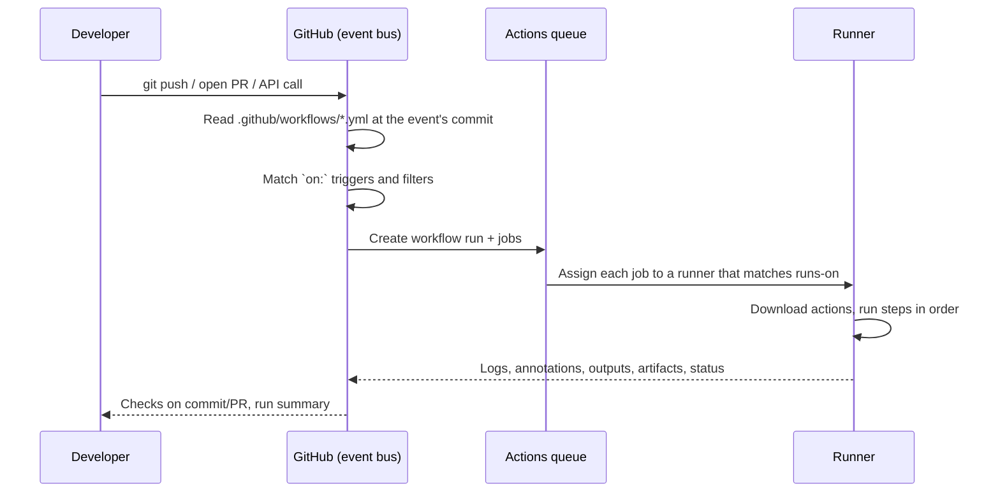

# Day 1 — Fundamentals, Workflow Syntax, and Triggers

> Exam domain: **Author and manage workflows (20–25%)** and **Consume and troubleshoot workflows (15–20%)**.
> Practice issues: [`label:topic:day-1`](../../issues?q=is%3Aissue+label%3Atopic%3Aday-1)

## Overview

GitHub Actions is an event-driven automation platform inside GitHub. An **event** (push, pull request, schedule, API call) starts a **workflow**. A workflow is a YAML file. It contains one or more **jobs**. Each job runs on a **runner** and executes **steps** in order. Steps run shell commands or reusable **actions**. You use this model for CI, CD, release automation, issue triage, and scheduled maintenance.

## Core components

| Component | Description |
|---|---|
| **Workflow** | YAML automation file in `.github/workflows/` (`.yml` or `.yaml`). Subdirectories are not supported. |
| **Event** | Activity that triggers a workflow |
| **Job** | Set of steps run on one runner; jobs run in parallel by default |
| **Step** | A shell command (`run`) or an action (`uses`) |
| **Action** | Reusable unit of work |
| **Runner** | Machine that executes a job |

Each job gets a fresh runner environment. Steps within a job share the filesystem. Jobs do not share a filesystem; pass data with outputs or artifacts.

## How a workflow run works



Step by step:

1. An event occurs. GitHub records the event **payload** (JSON). The payload is available as `github.event`.
2. GitHub reads the workflow files **at the commit SHA of the event** (for `push`, the pushed commit; for `pull_request`, the merge commit; for `schedule` and `workflow_dispatch`, the default or selected branch).
3. GitHub evaluates `on:` and its filters. If no filter matches, no run is created.
4. GitHub builds a job graph from `needs:`. Jobs without `needs:` start in parallel.
5. Each job is queued. A runner whose labels match `runs-on` picks it up.
6. The runner prepares actions (downloads, builds Docker images), then runs steps. Each `run` step is a new shell process.
7. The runner streams logs and posts results. The job status becomes a **check** on the commit.

## Anatomy of a workflow

```yaml
name: CI                      # display name
run-name: CI for ${{ github.actor }}
on:                           # triggers
  push:
    branches: [main]
  pull_request:
permissions:
  contents: read
env:
  NODE_ENV: test
defaults:
  run:
    shell: bash
jobs:
  build:
    runs-on: ubuntu-latest
    timeout-minutes: 15
    steps:
      - uses: actions/checkout@v7
      - name: Say hi
        run: echo "Hello"
        env:
          GREETING: hi
```

Key workflow-level keys: `name`, `run-name`, `on`, `permissions`, `env`, `defaults`, `concurrency`, `jobs`.
Key job-level keys: `runs-on`, `needs`, `if`, `strategy`, `env`, `permissions`, `outputs`, `environment`, `concurrency`, `container`, `services`, `timeout-minutes`, `continue-on-error`, `defaults`, `uses` (reusable workflow), `with`, `secrets`.
Key step-level keys: `name`, `id`, `if`, `uses`, `with`, `run`, `shell`, `env`, `working-directory`, `continue-on-error`, `timeout-minutes`.

## Triggers (events)

### Common events

| Event | Fires when |
|---|---|
| `push` | Commits or tags pushed |
| `pull_request` | PR opened, synchronize, reopened (default activity types) |
| `pull_request_target` | Like PR but runs in the context of the **base** branch with secrets: dangerous with untrusted code |
| `workflow_dispatch` | Manual run (supports `inputs`, up to 25) |
| `schedule` | Cron (UTC), minimum every 5 minutes; runs on default branch |
| `workflow_call` | Called by another workflow (reusable workflow) |
| `workflow_run` | After another workflow is `requested`, `in_progress` or `completed` |
| `repository_dispatch` | External API call with custom event type |
| `release`, `issues`, `issue_comment`, `create`, `delete`, `fork`, `watch` | Matching repo events |
| `check_run`, `check_suite`, `deployment`, `deployment_status`, `status` | Check/deployment related |
| `merge_group` | A PR enters a merge queue (required checks must listen to this event) |

### Activity types

Many events have **activity types**. Use `types:` to narrow them. If you omit `types:`, the default set applies (for `pull_request`: `opened`, `synchronize`, `reopened`).

```yaml
on:
  issues:
    types: [opened, labeled]
  release:
    types: [published]
  pull_request:
    types: [opened, synchronize, reopened, ready_for_review, closed]
```

To detect a merged PR, use `types: [closed]` and `if: github.event.pull_request.merged == true`.

### Filters

```yaml
on:
  push:
    branches: [main, 'release/**']
    branches-ignore: [...]      # cannot combine with branches
    tags: ['v*']
    paths: ['src/**']
    paths-ignore: ['docs/**']
  pull_request:
    types: [opened, synchronize, reopened, ready_for_review]
```

- `branches` and `branches-ignore` cannot be used together for the same event; use `!` negation patterns inside `branches` instead. Same for `paths` and `tags`.
- Order matters with negation: a later pattern overrides an earlier one. `['release/**', '!release/**-alpha']` includes release branches except alpha.
- Glob: `*` (no slash), `**` (any), `?`, `+`, `[]`, `!` negate. Quote patterns that start with `*`, `[` or `!`.
- If you define only `tags`, the workflow does not run for branch pushes, and the reverse.
- Path filters are not evaluated for tag pushes.
- `pull_request` `branches` filters match the **base** branch, not the head branch.
- If a push has more than 1,000 commits, or GitHub cannot compute the diff, path-filtered workflows always run.
- `schedule` uses POSIX cron: `'30 5 * * 1-5'` (5:30 UTC weekdays). Runs can be delayed at high load; the start of every hour is the busiest time.

### workflow_dispatch inputs

```yaml
on:
  workflow_dispatch:
    inputs:
      env:
        description: Target
        type: choice
        options: [dev, prod]
        required: true
      debug:
        type: boolean
        default: false
      replicas:
        type: number
        default: 2
      target:
        type: environment      # dropdown of repo environments
```

Input types: `string`, `boolean`, `number`, `choice`, `environment`. Access via `${{ inputs.env }}` (typed) or `github.event.inputs.env` (always a string). Up to 25 inputs.

Run it from the CLI: `gh workflow run ci.yml -f env=prod -f debug=true`.

### workflow_run and repository_dispatch

```yaml
# Runs after "CI" completes on main
on:
  workflow_run:
    workflows: ["CI"]
    types: [completed]
    branches: [main]
jobs:
  deploy:
    if: github.event.workflow_run.conclusion == 'success'
    runs-on: ubuntu-latest
    steps:
      - run: echo "CI run ${{ github.event.workflow_run.id }} passed"
```

```yaml
# Started by: gh api repos/OWNER/REPO/dispatches -f event_type=deploy -F client_payload[env]=prod
on:
  repository_dispatch:
    types: [deploy]
jobs:
  go:
    runs-on: ubuntu-latest
    steps:
      - run: echo "env=${{ github.event.client_payload.env }}"
```

- `workflow_run` runs in the context of the default branch and has access to secrets, even when the first workflow came from a fork. Treat its artifacts as untrusted.
- `workflow_run` can chain at most three levels.
- `repository_dispatch` and `workflow_run` only trigger if the workflow file is on the default branch.

### Important behaviors

- Workflow files must exist on the **default branch** to run for `schedule`, `workflow_dispatch` in the UI, `issue_comment`, `repository_dispatch`, `workflow_run`, etc.
- Events triggered by `GITHUB_TOKEN` generally **do not trigger new workflow runs** (prevents recursion), with exceptions `workflow_dispatch` and `repository_dispatch`. Use a PAT or GitHub App token to chain.
- Workflows from forks: `pull_request` from forks gets a read-only token and no secrets by default; approvals may be required for first-time contributors.
- Disable/enable workflows from the Actions tab; use `[skip ci]` / `[ci skip]` / `[no ci]` / `[skip actions]` / `[actions skip]` in the commit message to skip `push` and `pull_request` runs. A skipped required check blocks merge.
- Scheduled workflows in public repos are disabled automatically after 60 days without repository activity.

## YAML anchors and aliases (January 2026 outline)

GitHub Actions supports YAML **anchors** (`&name`) and **aliases** (`*name`) since September 2025. The parser expands them before the workflow runs.

```yaml
on:
  push:
    paths: &code_paths
      - 'src/**'
      - 'requirements.txt'
  pull_request:
    paths: *code_paths

jobs:
  test:
    runs-on: ubuntu-latest
    env: &py_env
      PYTHONUNBUFFERED: "1"
      PIP_DISABLE_PIP_VERSION_CHECK: "1"
    steps:
      - uses: actions/checkout@v7
      - &install
        name: Install deps
        run: pip install -r requirements.txt
  lint:
    runs-on: ubuntu-latest
    env: *py_env
    steps:
      - uses: actions/checkout@v7
      - *install
```

Rules:

- Anchors work **inside one file** only. They do not cross files. For cross-file reuse use reusable workflows or composite actions.
- An alias copies the whole node. You cannot change one field of an aliased mapping.
- **Merge keys (`<<: *anchor`) are not supported.** GitHub implements YAML 1.2; merge keys are a YAML 1.1 extension. Expect an exam distractor on this.
- When you troubleshoot, expand each alias in your head (or with `yq 'explode(.)' file.yml`) before you read the job.

## Runners (intro)

`runs-on: ubuntu-latest | windows-latest | macos-latest` or specific versions (`ubuntu-24.04`, `windows-2025`, `ubuntu-24.04-arm`). `ubuntu-slim` is a 1-vCPU low-cost Linux runner for light jobs. Self-hosted: `runs-on: [self-hosted, linux, x64]`. Larger runners exist on paid plans. `-latest` labels move to new images over time; pin a version when the toolchain matters.

## Shell and run steps

- Default shell: bash on Linux/macOS, pwsh on Windows. With no `shell:` key, Linux/macOS run `bash -e {0}` (no `pipefail`). With `shell: bash`, they run `bash --noprofile --norc -eo pipefail {0}`, so a failing command inside a pipe fails the step. Override with `shell:` (`bash`, `pwsh`, `python`, `sh`, `cmd`, `powershell`, or a custom `command {0}`).
- Multi-line: `run: |`.
- Each `run` step is a new shell process; env vars set with `export` do not persist. Persist with `echo "NAME=value" >> "$GITHUB_ENV"`. Add to PATH with `$GITHUB_PATH`. Step outputs with `echo "key=value" >> "$GITHUB_OUTPUT"`. Job summary markdown with `$GITHUB_STEP_SUMMARY`.
- Multi-line values in `GITHUB_ENV`/`GITHUB_OUTPUT` use a delimiter:

```bash
{
  echo "NOTES<<EOF"
  cat notes.txt
  echo "EOF"
} >> "$GITHUB_ENV"
```

## Workflow commands

- `::debug::`, `::notice::`, `::warning::`, `::error::` annotations. Add location: `::error file=app.py,line=10,col=5,title=Lint::Unused import`.
- `::add-mask::value` masks a value in logs.
- `::group::` / `::endgroup::` fold log sections.
- `::stop-commands::TOKEN` … `::TOKEN::` stops command processing (use when you print untrusted text).
- The old `set-output`, `save-state`, `set-env`, `add-path` commands are deprecated or disabled; use environment files.

## Editor tooling

- **GitHub Actions extension for VS Code** (`github.vscode-github-actions`): schema validation, auto-complete for keys and contexts, IntelliSense for action inputs, run/log viewer.
- **actionlint**: static checker. Finds bad contexts, wrong types, shellcheck issues in `run:`.
- Run both before you push. The exam asks which tool validates syntax **before** a run.

## Real-world example

A payments team runs CI on every PR to `main` but only when application code changes. Docs-only PRs skip CI. A nightly job runs integration tests at 02:15 IST (20:45 UTC). A release job runs only on tags.

```yaml
on:
  pull_request:
    branches: [main]
    paths-ignore: ['docs/**', '**.md']
  schedule:
    - cron: '45 20 * * *'      # 02:15 IST = 20:45 UTC
  push:
    tags: ['v*.*.*']
```

Risk: if `CI` is a **required check**, a docs-only PR never gets the check and the merge blocks. Fix: remove the path filter and skip inside the job, or use a small "always-pass" workflow with the same job name for ignored paths.

## Hands-on

Example files: [`examples/day-1/`](../examples/day-1/).

1. Run [Lab 1](../.github/workflows/lab-1-hello.yml) from the Actions tab or `gh workflow run "Lab 1 - Hello Actions" -f who=Varun`.
2. Run [Lab 1b — triggers and anchors](../.github/workflows/lab-1b-triggers-anchors.yml). Read the expanded job in the run log.
3. Lint locally: `actionlint`.

## Common mistakes

1. **Workflow in a subfolder** (`.github/workflows/ci/build.yml`). GitHub ignores it. Keep files directly in `.github/workflows/`.
2. **Using `branches` and `branches-ignore` together.** The file is invalid. Use `!` patterns.
3. **Expecting a push by `GITHUB_TOKEN` to start the next workflow.** It does not. Use a GitHub App token or `workflow_dispatch`.
4. **Schedule on a feature branch.** It never fires. Merge to the default branch.
5. **Using `export` to pass values between steps.** Write to `$GITHUB_ENV` or `$GITHUB_OUTPUT`.

## Troubleshooting

| Symptom | Cause | Fix |
|---|---|---|
| No run after push | Filter mismatch (`branches`, `paths`, `tags`) or `[skip ci]` in message | Check filters; check commit message; check the workflow is enabled |
| "Run workflow" button missing | No `workflow_dispatch`, or file not on default branch | Add trigger; merge to default branch |
| Cron did not run | File not on default branch; repo inactive 60 days (public); delay at peak | Merge; re-enable workflow; avoid `:00` |
| Required check "Expected — waiting for status" | Workflow skipped by path filter or `[skip ci]` | Remove filter or add a passing stub job with the same name |
| `Invalid workflow file` | YAML indentation; unknown key; merge key `<<` used | Run `actionlint`; remove merge keys |
| Value from step 1 empty in step 2 | Used `export` | Use `$GITHUB_ENV` |

## Exam notes

- `pull_request` default types: `opened`, `synchronize`, `reopened`.
- `schedule`: UTC, default branch, minimum 5 minutes.
- `GITHUB_TOKEN` events do not start runs, except `workflow_dispatch` and `repository_dispatch`.
- `github.event.inputs.*` values are strings; `inputs.*` keeps the type.
- YAML anchors: yes. Merge keys: no.
- Trick: "The workflow lives in `.github/workflows/deploy/prod.yml`." It never runs.

## References

- [Events that trigger workflows](https://docs.github.com/en/actions/reference/workflows-and-actions/events-that-trigger-workflows)
- [Workflow syntax](https://docs.github.com/en/actions/reference/workflows-and-actions/workflow-syntax)
- [Workflow commands](https://docs.github.com/en/actions/reference/workflows-and-actions/workflow-commands)
- [YAML anchors changelog](https://github.blog/changelog/2025-09-18-actions-yaml-anchors-and-non-public-workflow-templates/)

## Check yourself

1. Where must workflow files live? What format?
2. Which event types trigger a workflow from PRs by default?
3. Why won't a push made with `GITHUB_TOKEN` trigger another workflow? Which events are exceptions?
4. Which file do you append to in order to set an env var for later steps?
5. What time zone does `schedule` use?
6. Can you use `branches` and `branches-ignore` together?
7. Can you use `<<: *defaults` to merge an anchored mapping in a workflow?
8. Which branch does a `pull_request` `branches:` filter compare against?
