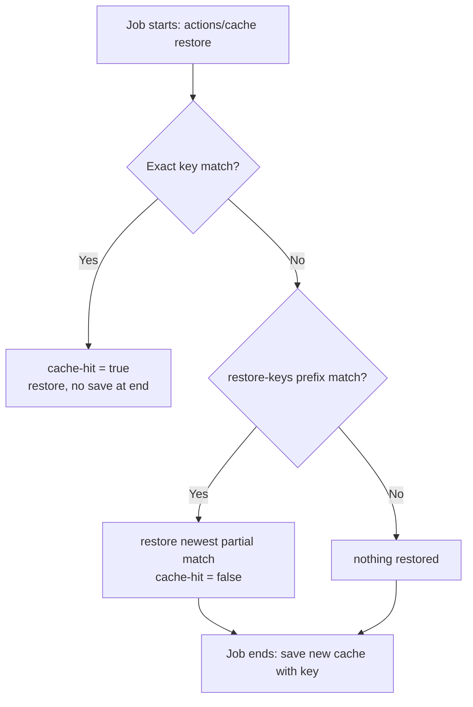

# Day 3 — Jobs: Dependencies, Matrix, Outputs, Artifacts, Caching, Containers

> Exam domains: **Author and manage workflows (20–25%)**, **Consume and troubleshoot workflows (15–20%)** (matrix analysis, artifacts), **Secure and optimize automation (10–15%)** (cache and retention).
> Practice issues: [`label:topic:day-3`](https://github.com/gvarun17/github-actions-gh200/issues?q=is%3Aissue+label%3Atopic%3Aday-3)

## Overview

A workflow is a **directed acyclic graph (DAG)** of jobs. `needs` defines the edges. A **matrix** turns one job definition into many parallel jobs. Jobs run on separate machines, so you move data between them with **outputs** (small strings) or **artifacts** (files). **Caches** keep dependencies between runs to save time. **Service containers** give a job a real database or queue for integration tests.

## Job graph

```mermaid
flowchart LR
    setup[setup<br/>outputs: matrix JSON] --> build
    subgraph build [build - matrix]
      b1[ubuntu / 3.12]
      b2[ubuntu / 3.13]
      b3[windows / 3.13]
    end
    build -->|artifacts: dist-*| test[integration-test<br/>services: postgres]
    test --> deploy[deploy<br/>environment: prod]
    build -.->|if: always()| report[report<br/>download all artifacts]
```

## Job dependencies

```yaml
jobs:
  build:
    runs-on: ubuntu-latest
    outputs:
      version: ${{ steps.v.outputs.version }}
    steps:
      - id: v
        run: echo "version=1.2.3" >> "$GITHUB_OUTPUT"
  deploy:
    needs: build            # waits; skipped if build fails unless if: always()
    if: needs.build.result == 'success'
    runs-on: ubuntu-latest
    steps:
      - run: echo "${{ needs.build.outputs.version }}"
```

- `needs` can be a string or list; creates a DAG.
- Default: jobs run in parallel; failure of a needed job skips dependents.
- Override: `if: ${{ always() }}`, `if: ${{ !cancelled() }}` or `if: failure()`.
- `needs.<job>.result` is `success`, `failure`, `cancelled`, or `skipped`.
- A skipped job counts as a success for **its** dependents only if they use `always()` or check the result; by default a dependent of a skipped job is also skipped.
- Job outputs are strings, max 1 MB per job and 50 MB per run. Outputs that contain a secret are redacted and **not sent** to the next job.

## Matrix strategy

```yaml
strategy:
  fail-fast: false          # default true: cancels other jobs when one fails
  max-parallel: 3
  matrix:
    os: [ubuntu-latest, windows-latest]
    node: [20, 22, 24]
    include:
      - os: ubuntu-latest
        node: 25
        experimental: true
    exclude:
      - os: windows-latest
        node: 20
runs-on: ${{ matrix.os }}
continue-on-error: ${{ matrix.experimental == true }}
```

How GitHub expands a matrix:

1. Build the cartesian product of all array keys (`os × node` = 6 jobs).
2. Remove every combination that matches an `exclude` entry (now 5).
3. Process each `include` entry: if it matches an existing combination without overwriting an original value, add its extra keys to that combination; otherwise add a new combination (now 6 including `node: 25`).

Rules:

- Max 256 jobs per matrix per workflow run.
- `include` adds combinations or extra keys; `exclude` removes combos (applied before include).
- Dynamic matrix: a prior job outputs JSON; `matrix: ${{ fromJSON(needs.setup.outputs.matrix) }}`.
- Job names in the UI follow the matrix values: `build (ubuntu-latest, 22)`. Use them to find the failing axis.
- You can **re-run a single matrix job** from the UI (re-run failed jobs or a single job). Up to 50 re-runs per run.
- **Outputs from a matrix job:** all legs write to the same output name; the last leg to finish wins. To collect per-leg results, use per-leg artifacts or distinct output names.
- Cost: a 3 OS × 4 versions matrix costs 12 jobs. Windows and macOS minutes cost more than Linux (macOS the most; the legacy rule of thumb was 2× and 10×). Check current per-minute rates in the runner pricing docs. Trim with `exclude`, run the full matrix only on `main`, and use `ubuntu-*` for most legs.
- `-latest` labels change images (for example `windows-latest` moved to Windows Server 2025; Ubuntu 20.04 is retired). Pin versions for reproducible matrices.

## Conditional execution

- Job-level `if:` is evaluated before the runner starts (no `steps` context, no secrets).
- Step-level `if:` evaluated per step.
- `continue-on-error: true` lets a job/step fail without failing the workflow.
- `timeout-minutes`: default 360 for jobs. Step timeout has no separate default (the job timeout applies).

## Artifacts

Share files between jobs or keep outputs after a run.

```yaml
- uses: actions/upload-artifact@v7
  with:
    name: build-output
    path: dist/
    retention-days: 7
    if-no-files-found: error
# in another job
- uses: actions/download-artifact@v8
  with:
    name: build-output
```

- Retention default 90 days. Public repos: 1–90 days. Private/internal repos: 1–400 days. Org/enterprise admins set the maximum.
- Artifact names must be unique within a run; artifacts are immutable after upload (upload again with `overwrite: true`).
- Download many: `pattern: dist-*` and `merge-multiple: true`.
- Artifacts are for files from a run; **caches** are for dependencies reused across runs.
- Use `gh run download <run-id> -n build-output` to fetch artifacts via CLI; storage counts against plan quota.
- REST: `GET /repos/{owner}/{repo}/actions/artifacts`, `DELETE /repos/{owner}/{repo}/actions/artifacts/{id}`.
- Retention settings by API: `PUT /repos/{owner}/{repo}/actions/permissions/artifact-and-log-retention` (and the org equivalent) with `{"days": N}`.

## Caching

```yaml
- uses: actions/cache@v5
  with:
    path: ~/.npm
    key: ${{ runner.os }}-npm-${{ hashFiles('**/package-lock.json') }}
    restore-keys: |
      ${{ runner.os }}-npm-
```



- Exact `key` match = cache hit. `restore-keys` provide fallback prefix matches (most recent).
- `cache-hit` output tells exact match. Skip the install step with `if: steps.cache.outputs.cache-hit != 'true'`.
- A cache entry is **immutable**. A hit never updates it. Change the key to refresh.
- Caches are scoped by branch: a workflow can restore from the current branch, the base branch (for PRs), and the default branch, but not sibling or child branches.
- Repo cache: 10 GB included per repository. Since Nov 2025, admins (enterprise, org, repo) can raise the eviction limit; usage above 10 GB is billed (Pro/Team/Enterprise). Entries unused for 7 days are evicted (retention limit configurable); oldest are evicted when over the size limit, now checked hourly.
- Split restore and save with `actions/cache/restore` and `actions/cache/save` for fine control (for example, save even when tests fail).
- Many `setup-*` actions have built-in caching (e.g., `cache: npm` for setup-node, `cache: pip` for setup-python).
- Cache vs artifact: cache = speed up repeated installs; artifact = deliver results.
- Manage: `gh cache list`, `gh cache delete <key>`, REST `GET /repos/{owner}/{repo}/actions/caches`.
- Never cache secrets or tokens. A PR from a fork can read caches from the base branch.

## Service containers and job containers

```yaml
jobs:
  test:
    runs-on: ubuntu-latest
    container: python:3.13-slim  # run the job's steps inside this container
    services:
      postgres:
        image: postgres:16
        env:
          POSTGRES_PASSWORD: pw
        ports: ['5432:5432']
        options: >-
          --health-cmd pg_isready --health-interval 10s
          --health-timeout 5s --health-retries 5
```

- Services are Docker containers attached to the job for databases, caches, etc. GitHub starts them before the steps and removes them after.
- If the job runs in a container, reach the service by its label hostname (`postgres`) on the container port. If the job runs directly on the runner, use `localhost` plus mapped port.
- Health checks (`--health-cmd`) make the job wait until the service is ready.
- `ports: ['5432']` (no host port) maps to a random host port; read it from `${{ job.services.postgres.ports['5432'] }}`.
- Private images need `credentials: { username, password }`.
- Container jobs and services require Linux runners.
- Docker container **actions** only run on Linux runners.

## Concurrency (intro)

```yaml
concurrency:
  group: ${{ github.workflow }}-${{ github.ref }}
  cancel-in-progress: true
```
Only one run per group; others pending or cancelled. Covered more on Day 4.

## Defaults and limits to remember

| Limit | Value |
|---|---|
| Job execution time (GitHub-hosted) | 6 h |
| Job execution time (self-hosted) | 5 days |
| Workflow run time | 35 days (includes waits and approvals) |
| Queue time (self-hosted) | 24 h, then cancelled |
| Matrix jobs per run | 256 |
| Re-runs per run | 50 |
| Concurrent jobs (standard hosted) | Free 20, Pro 40, Team 60, Enterprise 500; macOS 5 / 5 / 5 / 50 |
| `GITHUB_TOKEN` API rate | 1,000 req/h per repo; 15,000 on Enterprise Cloud |
| Workflow file size | 500 KB |
| Reusable workflows (github.com) | 10 levels, 50 unique per run tree (GHES: 4 and 20) |

## Real-world example

A Python library supports 3.11–3.13 on Linux and only 3.13 on Windows and macOS. A PR runs a trimmed matrix (Linux only). A push to `main` runs the full matrix. A `report` job always runs, downloads every `junit-*` artifact and writes a summary. The database layer is tested against a Postgres service.

```yaml
jobs:
  setup:
    runs-on: ubuntu-latest
    outputs:
      matrix: ${{ steps.m.outputs.matrix }}
    steps:
      - id: m
        run: |
          if [ "${{ github.event_name }}" = "pull_request" ]; then
            echo 'matrix={"os":["ubuntu-latest"],"py":["3.11","3.12","3.13"]}' >> "$GITHUB_OUTPUT"
          else
            echo 'matrix={"os":["ubuntu-latest"],"py":["3.11","3.12","3.13"],"include":[{"os":"windows-latest","py":"3.13"},{"os":"macos-latest","py":"3.13"}]}' >> "$GITHUB_OUTPUT"
          fi
  test:
    needs: setup
    strategy:
      fail-fast: false
      matrix: ${{ fromJSON(needs.setup.outputs.matrix) }}
    runs-on: ${{ matrix.os }}
    steps:
      - run: echo "test on ${{ matrix.os }} / ${{ matrix.py }}"
```

## Hands-on

Example files: [`examples/day-3/`](../examples/day-3/).

1. Run [Lab 3](../.github/workflows/lab-3-matrix-artifacts.yml). Open the `collect` job and find each artifact.
2. Run [Lab 3b — dynamic matrix, cache, services](../.github/workflows/lab-3b-dynamic-matrix-services.yml). Run it twice; the second run shows `cache-hit=true`.
3. Run `python3 examples/day-3/matrix_expand.py examples/day-3/matrix.json` to predict the job list before you push.
4. Run `gh cache list` and `gh run download`.

## Common mistakes

1. **Expecting a matrix job's output to hold every leg's value.** Only the last writer wins.
2. **Using `localhost` from a container job.** Use the service label (`postgres`).
3. **Cache key without `hashFiles`.** The cache never refreshes when dependencies change.
4. **Caching `node_modules` across OSes.** Include `runner.os` in the key.
5. **Two uploads with the same artifact name in a matrix.** v4+ fails; add matrix values to the name.

## Troubleshooting

| Symptom | Cause | Fix |
|---|---|---|
| Dependent job "skipped" | A needed job failed or was skipped | Add `if: ${{ !cancelled() }}` or check `needs.x.result` |
| `Unable to find any artifacts` | Name mismatch; artifact from another run; expired | Match names; use `run-id` + `github-token` inputs; check retention |
| `Conflict: an artifact with this name already exists` | Same name in matrix legs | Name `out-${{ matrix.os }}-${{ matrix.py }}` |
| Cache never hits on PR | Cache saved on a sibling branch | Seed the cache on the default branch |
| Cache hit but stale deps | Key does not include lockfile hash | Use `hashFiles('**/lockfile')` |
| Service `connection refused` | No health check; wrong host | Add `--health-cmd`; use label vs `localhost` correctly |
| `Container action is only supported on Linux` | Job on Windows/macOS | Use Linux runner or a JS/composite action |

## Exam notes

- `fail-fast` default is `true`.
- `exclude` is applied before `include`.
- Caches: read from current, base and default branches only.
- Artifact retention: public max 90 days, private max 400 days.
- Job timeout default 360 minutes.
- Trick: "Make job C run after A and B, even when B fails" → `needs: [A, B]` and `if: ${{ !cancelled() }}` (or `always()`).

## References

- [Using jobs / needs](https://docs.github.com/en/actions/how-tos/write-workflows/choose-what-workflows-do/use-jobs)
- [Running variations of jobs (matrix)](https://docs.github.com/en/actions/how-tos/write-workflows/choose-what-workflows-do/run-job-variations)
- [Dependency caching reference](https://docs.github.com/en/actions/reference/workflows-and-actions/dependency-caching)
- [Store and share data with artifacts](https://docs.github.com/en/actions/tutorials/store-and-share-data)
- [Service containers](https://docs.github.com/en/actions/tutorials/use-containerized-services)
- [Actions limits](https://docs.github.com/en/actions/reference/limits)
- [Cache above 10 GB (changelog)](https://github.blog/changelog/2025-11-20-github-actions-cache-size-can-now-exceed-10-gb-per-repository/)

## Check yourself

1. What does `fail-fast: false` change?
2. How do you pass data from one job to another (two ways)?
3. What cache key behavior do `restore-keys` provide?
4. When would you use `if: always()` on a job with `needs`?
5. How do you reach a service container from a job that runs in a container vs on the runner?
6. Difference between artifacts and cache?
7. A 3×3 matrix has one `exclude` and one `include` that adds a new combination. How many jobs run?
8. What is the maximum artifact retention for a private repository?
