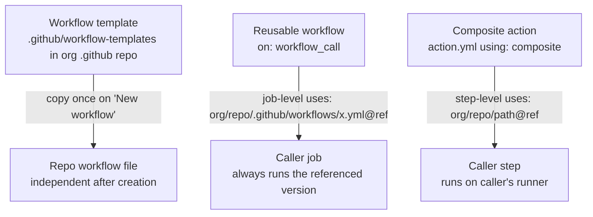
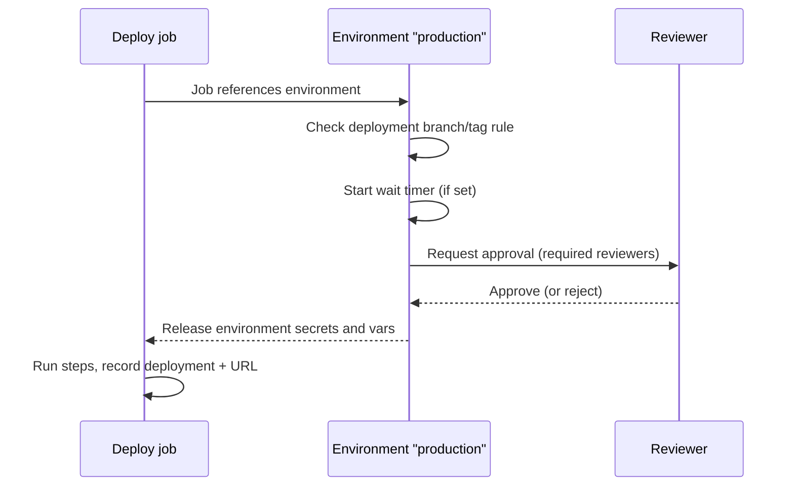
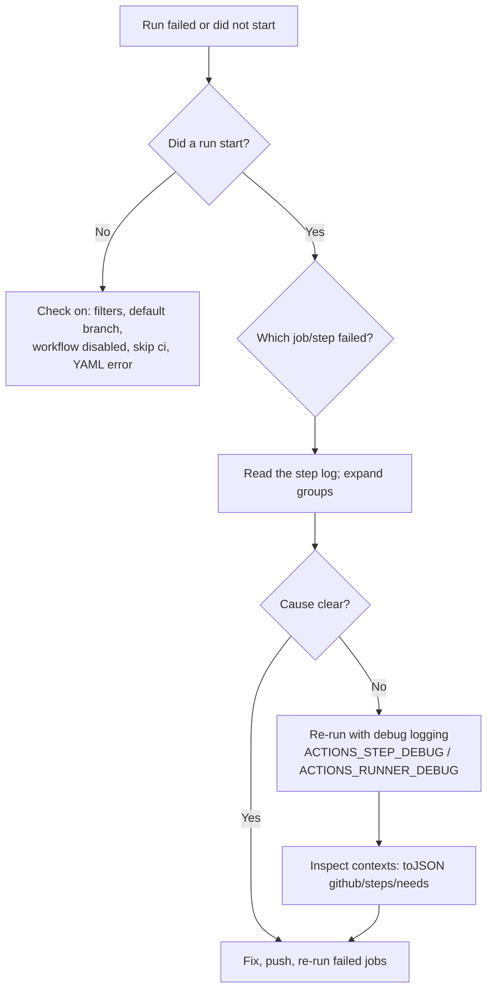

# Day 4 — Reuse, Environments, Concurrency, and Debugging

> Exam domains: **Consume and troubleshoot workflows (15–20%)**, **Author and manage workflows (20–25%)** (reusable workflow inputs/secrets, environment protections), **Secure and optimize automation (10–15%)** (approval gates).
> Practice issues: [`label:topic:day-4`](https://github.com/gvarun17/github-actions-gh200/issues?q=is%3Aissue+label%3Atopic%3Aday-4)

## Overview

At scale you do not copy YAML between repos. You **reuse** it: reusable workflows (whole jobs), composite actions (steps) and workflow templates (a starting copy). You protect deployments with **environments** (reviewers, wait timers, branch rules, scoped secrets). You control overlap with **concurrency**. When something breaks, you **debug** with logs, re-runs and debug logging.

## Three ways to reuse



| | Workflow template (starter) | Reusable workflow | Composite action |
|---|---|---|---|
| What you get | A **copy** of YAML | A **call** to central YAML | A **call** to central steps |
| Updates reach callers | No (copy is independent) | Yes (by ref) | Yes (by ref) |
| Level | Whole file | Whole job(s) | Steps within a job |
| Runner | N/A | Chooses own `runs-on` | Uses caller's runner |
| Secrets | N/A | Passed explicitly or `inherit` | Accessed through inputs |
| Visibility in logs | N/A | Separate jobs | One step in the job |
| Defined in | `workflow-templates/*.yml` + `*.properties.json` | `.github/workflows/` | `action.yml` |

## Reusable workflows

Called with `workflow_call`.

**Called workflow** (`.github/workflows/build.yml`):
```yaml
on:
  workflow_call:
    inputs:
      node-version:
        type: string
        required: true
    secrets:
      npm_token:
        required: false
    outputs:
      artifact-name:
        value: ${{ jobs.build.outputs.name }}
jobs:
  build:
    runs-on: ubuntu-latest
    outputs:
      name: ${{ steps.n.outputs.name }}
    steps:
      - id: n
        run: echo "name=dist" >> "$GITHUB_OUTPUT"
```

**Caller**:
```yaml
jobs:
  call-build:
    uses: ./.github/workflows/build.yml          # same repo
    # uses: org/repo/.github/workflows/build.yml@v1   # another repo
    with:
      node-version: '20'
    secrets: inherit                              # or map explicitly
```

Rules:
- Reusable workflow is called at the **job** level (`uses:` on a job), not as a step.
- Cannot be combined with `runs-on`, `steps` in the calling job. Allowed caller keys: `name`, `uses`, `with`, `secrets`, `needs`, `if`, `permissions`, `concurrency`, `strategy`.
- Inputs pass via `with` (types: `boolean`, `number`, `string`); use `secrets` or `secrets: inherit`.
- `secrets: inherit` passes the caller's **repository and organization** secrets. It does **not** pass environment secrets, because the caller job cannot declare `environment:`. Environment secrets reach only a job that declares `environment:` — put that job inside the called workflow.
- Reference by path+ref: `@main`, `@v1`, or a SHA (SHA safest). Local calls (`./.github/workflows/x.yml`) use the same commit as the caller.
- `env` context of caller is not passed; use inputs.
- The `github` context in the called workflow is the **caller's** context. `actions/checkout` checks out the caller's repo.
- Caller permissions can only downgrade the `GITHUB_TOKEN` permissions in the called workflow, not elevate.
- Nesting depth: **10 levels** (caller + 9) and **50 unique reusable workflows** per run tree on github.com (GHES: 4 and 20).
- Private repo reuse requires access to be enabled in repo Settings → Actions → General → Access.
- Matrix can be used with reusable workflow calls (`strategy.matrix` on the caller job).
- Billing for hosted runners goes to the caller.
- Outputs flow: step output → job `outputs` in called workflow → `on.workflow_call.outputs` → caller `needs.<call-job>.outputs.<name>`.

## Workflow templates

Templates offered in "New workflow" UI. Organization templates live in the org's `.github` repo under `workflow-templates/`. Each template needs a `.yml` file and a matching `.properties.json` (`name`, `description`, `iconName`, `categories`, `filePatterns`). The placeholder `$default-branch` is replaced on creation.

- Since September 2025, templates can come from a **non-public** (private or internal) `.github` repo. Members who can read that repo see the templates.
- After creation the copy is independent. Fixing the template does not fix existing copies — that is why central logic belongs in reusable workflows.

```json
{
  "name": "Python CI (Platform)",
  "description": "Lint and test with the platform defaults.",
  "iconName": "python",
  "categories": ["Python"],
  "filePatterns": ["requirements.txt$", "pyproject.toml$"]
}
```

## Environments and deployment protection

```yaml
jobs:
  deploy:
    environment:
      name: production
      url: ${{ steps.deploy.outputs.url }}
```



Environments (repo Settings → Environments):
- **Required reviewers** (up to 6 people or teams; one approval is enough). Option: prevent self-review.
- **Wait timer** delay (0–43,200 minutes = 30 days).
- **Deployment branches/tags** restrict which refs can deploy (all, protected branches only, or selected patterns).
- **Environment secrets and variables** available only to jobs referencing the environment (and released after approval).
- **Custom deployment protection rules** via GitHub Apps (for example a change-management or monitoring check).
- Admins can be allowed to bypass protection rules (setting).
- Plans: public repos — all current plans. Private/internal repos — environments, environment secrets and deployment branches need Pro/Team/Enterprise; required reviewers and wait timers on Free/Pro/Team work **only in public repos**.
- A job waits for approval for up to 30 days, then fails.

## Concurrency

```yaml
concurrency:
  group: deploy-${{ github.ref }}
  cancel-in-progress: false
```
- Defined at workflow or job level. Group names are case-insensitive and span the whole repo (not one workflow), so include `github.workflow` to avoid collisions.
- Default: at most one running and one pending per group; a newer pending run **replaces** (cancels) the older pending one.
- `cancel-in-progress: true` cancels the running one when a new one arrives. Use it for PR CI.
- **`queue: max`** (May 2026): keeps up to 100 jobs/runs waiting in order instead of only one. Only valid when `cancel-in-progress` is `false` or unset. Use it for deploys where every run must execute.
- Use a fallback in group keys: `group: ${{ github.head_ref || github.run_id }}` so non-PR events get a unique group.
- `cancel-in-progress` accepts an expression: `${{ github.ref != 'refs/heads/main' }}` (cancel on branches, never on main).

```yaml
# Deploys: serialize, keep every run
concurrency:
  group: ${{ github.workflow }}-prod
  cancel-in-progress: false
  queue: max
```

## Manage workflow runs

- **Re-run** all jobs, failed jobs only, or a single job; re-run with **debug logging**. Re-runs use the same `GITHUB_SHA` and `GITHUB_REF`; `github.run_attempt` increases. Max 50 re-runs per run. Re-run is possible for 30 days.
- **Cancel** a run (`gh run cancel <id>`). After cancel, steps with `if: always()` **still run**, and `if: cancelled()` steps run. Steps with the default `success()` do not. Use `if: ${{ !cancelled() }}` to skip on cancel.
- **Force cancel** (`POST /repos/{owner}/{repo}/actions/runs/{id}/force-cancel`) ignores `always()` conditions when a run hangs.
- **Delete** runs and logs; logs retained 90 days by default (same setting as artifacts).
- **Disable vs delete a workflow:** disabling keeps the file and history and stops new runs (`gh workflow disable`). Deleting the file removes the workflow from the list once its runs are gone; history stays until runs are deleted. Disable is reversible and the right answer for "pause temporarily".
- **Status badges**: `https://github.com/<owner>/<repo>/actions/workflows/<file>.yml/badge.svg` (`?branch=main`, `?event=push`).
- **Workflow summaries**: write markdown to `$GITHUB_STEP_SUMMARY` (max 1 MiB per step, 20 summaries shown per job).
- **Annotations** surface errors/warnings on PRs (max 10 error + 10 warning per step, 50 per job shown).
- **Required status checks**: workflow job names must match required checks in branch protection or rulesets; skipped path-filtered workflows can leave a required check "pending."

## Debugging



- Enable **step debug logging**: secret or variable `ACTIONS_STEP_DEBUG=true`.
- Enable **runner diagnostic logging**: `ACTIONS_RUNNER_DEBUG=true` (adds runner and worker logs to the log archive).
- "Re-run jobs → Enable debug logging" sets them for that run. In a step, `runner.debug` is `1` when debug is on.
- `::debug::message` only shows with debug on.
- Download log archive from run page (`gh run view <id> --log` or `--log-failed`); view raw logs.
- Common errors: wrong indentation, undefined contexts, missing `permissions`, workflow not on default branch, secrets unavailable on fork PRs, path filters excluding changes, expired caches, runner label typo (job stays queued).
- Validate with VS Code GitHub Actions extension or `actionlint`.
- `act` runs workflows locally (third-party).

## Using actions from Marketplace and elsewhere

`uses:` formats:
- `actions/checkout@v7` (public repo, tag)
- `owner/repo/path@ref` (subdirectory action)
- `./.github/actions/my-action` (local, requires `checkout` first)
- `docker://alpine:3.20` (Docker Hub image)
- `docker://ghcr.io/owner/image:tag` (other registry)

Pinning: tag (mutable), branch (least safe), **full commit SHA (immutable, recommended)**. Org/enterprise policy can allow only GitHub-authored, verified creators, or an allow list, block specific actions, and **require SHA pinning**. Workflow lockfiles (`.github/workflows/actions.lock`, GA Oct 2026) record resolved commits for direct and transitive dependencies. Trust signals in Marketplace: verified creator badge, stars/usage, recent releases, open security advisories, source you can read.

## Real-world example

A company has 120 microservice repos. The platform team keeps `org/ci-workflows` with `python-ci.yml` and `deploy-eks.yml` (reusable, tagged `v3`). Each service repo has a 15-line caller. Production deploys need the `production` environment (2 SRE reviewers, `main` only, 10-minute wait timer). Deploys use `concurrency: { group: prod-${{ github.repository }}, queue: max }` so no deploy is dropped. When the platform team fixes a bug, they move the `v3` tag; all repos get the fix on the next run.

## Hands-on

Example files: [`examples/day-4/`](../examples/day-4/).

1. Run [Lab 4](../.github/workflows/lab-4-reusable-caller.yml). Trigger it twice quickly and watch `cancel-in-progress`.
2. Create environment `lab-prod` with yourself as required reviewer (the repo is public, so this works on Free). Run [Lab 4b — environments and concurrency](../.github/workflows/lab-4b-environment-concurrency.yml). Approve the job.
3. Trigger Lab 4b three times. With `queue: max`, all three wait and run in order.
4. Copy `examples/day-4/workflow-templates/` into an org `.github` repo to publish a template.

## Common mistakes

1. **Putting `uses: ./.github/workflows/x.yml` under `steps:`.** Reusable workflows go on the job.
2. **Adding `runs-on` to the caller job.** Not allowed with `uses:`.
3. **Expecting `secrets: inherit` to pass environment secrets.** It passes repo/org secrets only.
4. **Using `if: always()` for cleanup that must stop on cancel.** Use `!cancelled()`.
5. **Fixing a workflow template and expecting repos to update.** Templates are copies.
6. **`queue: max` with `cancel-in-progress: true`.** Validation error.

## Troubleshooting

| Symptom | Cause | Fix |
|---|---|---|
| `error parsing called workflow ... workflow was not found` | Wrong path/ref; private repo access not granted | Fix `uses:`; enable Access in the called repo settings |
| Called workflow cannot read secret | Not passed | `secrets: inherit` or map it |
| Job "Waiting for review" forever | No reviewer acts; 30-day limit | Add reviewers; check notifications |
| Job fails "Branch not allowed to deploy" | Deployment branch rule | Deploy from allowed ref or update rule |
| Second deploy disappeared | Default concurrency replaced the pending run | Add `queue: max` |
| Job queued forever | No runner matches labels | Fix `runs-on`; check runner group access |
| No debug lines | Debug not enabled | Set `ACTIONS_STEP_DEBUG=true` or re-run with debug |

## Exam notes

- Reusable workflow: job-level `uses`, `on: workflow_call`, `secrets: inherit`.
- Limits (github.com): 10 levels, 50 workflows.
- Required reviewers: up to 6; one approval needed.
- `always()` runs after cancel; `!cancelled()` does not.
- Disable workflow = pause, reversible.
- Trick: "Every queued deploy must run in order" → `concurrency` + `queue: max`, not `cancel-in-progress`.

## References

- [Reuse workflows](https://docs.github.com/en/actions/how-tos/reuse-automations/reuse-workflows)
- [Reusable workflows reference](https://docs.github.com/actions/reference/reusable-workflows-reference)
- [Create workflow templates](https://docs.github.com/en/actions/how-tos/reuse-automations/create-workflow-templates)
- [Managing environments](https://docs.github.com/en/actions/how-tos/deploy/configure-and-manage-deployments/manage-environments)
- [Control concurrency](https://docs.github.com/en/actions/how-tos/write-workflows/choose-when-workflows-run/control-workflow-concurrency)
- [Concurrency queue changelog](https://github.blog/changelog/2026-05-07-github-actions-concurrency-groups-now-allow-larger-queues)
- [Enable debug logging](https://docs.github.com/en/actions/how-tos/monitor-workflows/enable-debug-logging)

## Check yourself

1. How is a reusable workflow called, and at which level?
2. How do you pass all secrets to a called workflow?
3. What does `cancel-in-progress` do? What does `queue: max` add?
4. Which feature requires manual approval before a job gets environment secrets?
5. How do you enable debug logging, and what are the two variables?
6. Why might a required check hang as "Expected — waiting for status"?
7. A template was fixed last week. Why do old repos still have the bug?
8. Which status function runs a step after cancel: `always()`, `!cancelled()`, or both?
