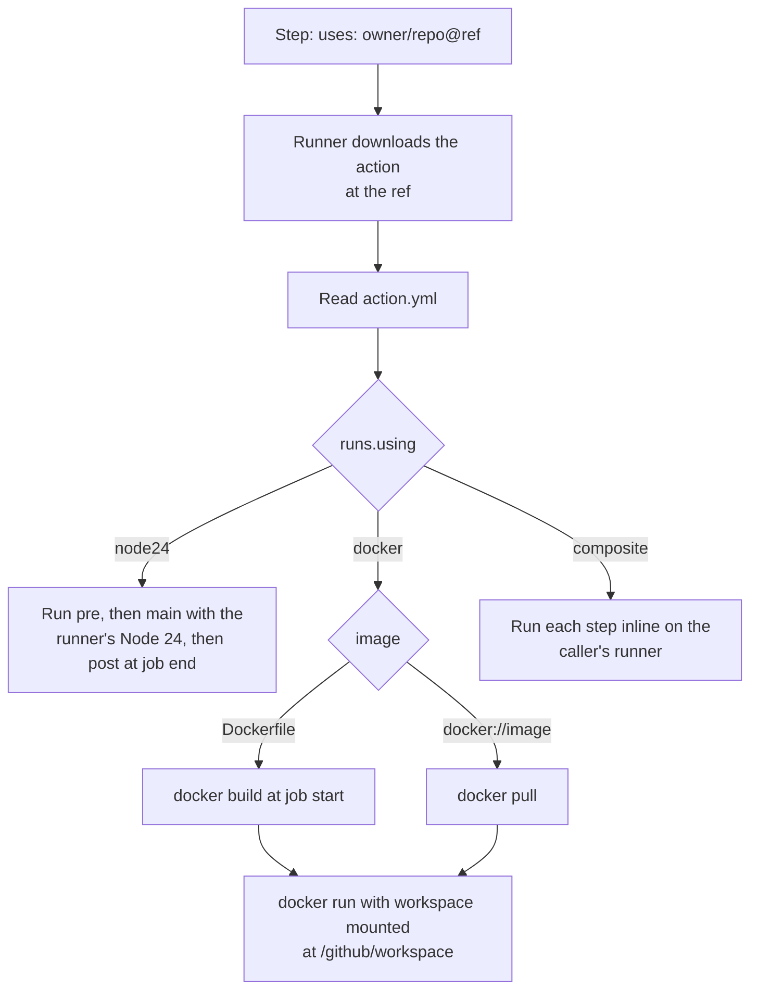

# Day 5 — Authoring Custom Actions

> Exam domain: **Author and maintain actions (15–20%)**. Also **Secure and optimize automation** (immutable actions, pinning).
> Practice issues: [`label:topic:day-5`](https://github.com/gvarun17/github-actions-gh200/issues?q=is%3Aissue+label%3Atopic%3Aday-5)

## Overview

An **action** is a reusable unit that a step calls with `uses:`. You write one when the same logic appears in many workflows, or when you want to share it in the Marketplace. There are three types: **JavaScript** (fast, all OSes), **Docker container** (any language, Linux only) and **composite** (a bundle of steps). Every action has an `action.yml` file that declares its inputs, outputs and how it runs.

## How the runner executes each action type



Inputs reach the code as `INPUT_<NAME>` environment variables (name upper-cased, spaces → `_`; dashes are kept). Outputs go to `$GITHUB_OUTPUT`. Exit code 0 = success.

## Three types of actions

| Type | Runs on | Pros | Cons |
|---|---|---|---|
| **JavaScript** | Runner directly (Node 24) | Fast start, cross-platform (Linux/Windows/macOS), toolkit access | Must bundle dependencies |
| **Docker container** | Linux runners only | Any language/tooling, consistent environment | Slower (image build/pull), Linux only |
| **Composite** | Caller's runner | Combine run steps and other actions, any OS | No `pre`/`post`; no direct `secrets`; nested logs less detailed |

Node runtime status: Node 20 was **removed** from runners on 2026-09-23. Use `using: node24`. The temporary opt-out `ACTIONS_ALLOW_USE_UNSECURE_NODE_VERSION` no longer works.

## action.yml metadata

File must be named `action.yml` or `action.yaml` at the action's root (or its subdirectory for `owner/repo/path@ref`).

```yaml
name: Greet
description: Say hello
author: me
inputs:
  who:
    description: Who to greet
    required: true
    default: World
    # deprecationMessage: "Use 'name' instead"
outputs:
  time:
    description: Time of greeting
    value: ${{ steps.t.outputs.time }}   # composite only
runs:
  using: composite
  steps:
    - id: t
      run: echo "time=$(date)" >> "$GITHUB_OUTPUT"
      shell: bash                         # REQUIRED for run steps in composite
    - run: echo "Hello ${{ inputs.who }}"
      shell: bash
branding:
  icon: heart
  color: red
```

- `required: true` is **not enforced** by the runner. Validate inputs in your code.
- `name` and `description` are required. `runs` is required.
- `branding` sets the Marketplace icon (Feather icon name) and color.

### JavaScript action

```yaml
runs:
  using: node24
  main: dist/index.js
  pre: dist/setup.js          # optional
  post: dist/cleanup.js       # optional
  pre-if: runner.os == 'Linux'
  post-if: always()           # default for post
```
- Use `@actions/core` (inputs, outputs, logging, `setFailed`, `setSecret`, `summary`), `@actions/github` (Octokit and context), `@actions/exec`, `@actions/tool-cache`, `@actions/cache`, `@actions/artifact`, `@actions/io`, `@actions/glob`.
- `core.getInput('who', { required: true })`, `core.setOutput('time', t)`, `core.setFailed(msg)`, `core.saveState()` / `core.getState()` to pass data from `main` to `post`.
- Commit `node_modules` or bundle with `@vercel/ncc` (or esbuild/rollup) into `dist/` and **commit `dist/`**. The runner does not run `npm install`.
- Inputs arrive as environment variables `INPUT_<NAME>` (uppercased).
- Exit code non-zero = failure; `core.setFailed` sets failing exit code.

```js
// index.js
const core = require('@actions/core');
try {
  const who = core.getInput('who', { required: true });
  core.info(`Hello, ${who}`);
  core.setOutput('time', new Date().toISOString());
  await core.summary.addHeading('Greeting').addRaw(`Hello ${who}`).write();
} catch (err) {
  core.setFailed(err.message);
}
```

### Docker container action

```yaml
runs:
  using: docker
  image: Dockerfile            # or docker://ghcr.io/org/img:tag
  args:
    - ${{ inputs.who }}
  entrypoint: /entrypoint.sh
  pre-entrypoint: /setup.sh
  post-entrypoint: /cleanup.sh
  env:
    FOO: bar
```
- Linux only. Workspace mounted at `/github/workspace`; it is also the working directory. The runner sets `GITHUB_*` variables in the container.
- Use `ENTRYPOINT` in the Dockerfile with **exec form** (`["/entrypoint.sh"]`) so `args` are passed correctly. Do not set `WORKDIR` expecting it to be used; GitHub overrides it.
- The container runs as root by default; files it writes in the workspace are owned by root.
- Prefer prebuilt image reference (`docker://ghcr.io/...`) for faster startup; `Dockerfile` builds on every job.

### Composite actions

- Steps can use `run` (must specify `shell`) and `uses`.
- Cannot use secrets context directly; accept as inputs.
- Outputs map from step outputs via `value:`.
- Each composite step can have `if`, `env`, `working-directory`, `continue-on-error`, `name`, `id`.
- Reference files in the action's own folder with `${{ github.action_path }}` (for example `run: ${{ github.action_path }}/script.sh`).

## Workflow commands from actions

Write to files: `GITHUB_OUTPUT`, `GITHUB_ENV`, `GITHUB_STATE`, `GITHUB_PATH`, `GITHUB_STEP_SUMMARY`. `GITHUB_STATE` passes data from `pre`/`main` to `post` (read as `STATE_<name>`). Annotations: `::error file=,line=::msg`. Masking: `::add-mask::` or `core.setSecret()`.

## Project layout and versioning

```
my-action/                  # public repo for Marketplace
├── action.yml              # one action at the root
├── src/index.js
├── dist/index.js           # committed bundle
├── package.json
├── README.md               # usage, inputs, outputs, permissions
├── LICENSE
└── .github/workflows/test.yml   # uses: ./ to test the action itself
```

- Public action = its own repo (needed for Marketplace). Private/internal can live in a monorepo path: `uses: org/repo/path@ref`.
- Local action: `./.github/actions/name` (needs `actions/checkout` first).
- **Versioning**: semantic version tags (`v1.2.3`) plus a moving major tag (`v1`) updated to latest compatible release. Branches (`main`) are unstable. SHA pin for consumers. Breaking change → new major (`v2`).
- **Immutable releases** (GA Oct 2025): when enabled on the repo or org, a new release's tag cannot be moved or deleted and its assets are locked. GitHub also creates a signed release attestation. For actions this means: publish each version (`v1.2.4`) as an immutable release; consumers who pin that tag get the same code every time. A moving major tag (`v1`) must then be a **plain Git tag, not a release**, so you can still move it.
- **Consumer controls**: org/repo policy can **require SHA pinning**; workflow **lockfiles** (`.github/workflows/actions.lock`, generated by `gh actions-lock`, GA Oct 2026) record the resolved commit of every direct and transitive action; Dependabot updates both.
- **Releases**: publish to Marketplace by drafting a release and checking "Publish this action to the GitHub Marketplace." Requirements:
  - The repo is **public**.
  - The repo has a **single action metadata file at the root** (`action.yml`/`action.yaml`). It should contain only the action and the files it needs.
  - The `name` is unique: not an existing Marketplace action, category, reserved GitHub feature name, or another user/org name.
  - The owner accepted the **Marketplace Developer Agreement**.
  - Your account has **2FA** enabled.
  - Actions are published immediately; GitHub does not review them.
- Marketplace badge "Verified creator" for verified orgs.
- **README** with usage example, inputs, outputs, required `permissions`; `LICENSE`.

## Distribution scope

| Scope | How |
|---|---|
| Public | Public repo (+ Marketplace optionally) |
| Private within user | Private repo; usable only by workflows in the same repo |
| Internal within org/enterprise | Private/internal repo with Settings → Actions → General → Access "Accessible from repositories in the org/enterprise" |

## Debugging and testing actions

- Test in a workflow in the same repo using `uses: ./`.
- Use `ACTIONS_STEP_DEBUG` and `core.debug`.
- Unit test with Jest (or `node --test`); integration test via workflow on push and on a matrix of OSes.
- Check `dist/` is current in CI (`npm run build && git diff --exit-code dist/`).
- Security: validate inputs, avoid shell injection (pass inputs through `env` in composite `run` steps), pin dependencies, document minimal permissions, don't log secrets, mark derived secrets with `core.setSecret`.

## Real-world example

An SRE team writes `org/notify-incident` — a JavaScript action that posts a formatted message to PagerDuty and Slack when a deploy fails. It reads `severity` and `service` inputs, uses `core.setSecret` on the API key input, writes a job summary and sets output `incident-id`. They publish `v1.0.0` and move `v1`. Consumers pin the SHA and let Dependabot (`package-ecosystem: github-actions`) open update PRs.

## Hands-on

1. Read the working [composite action](../actions/greet-composite/action.yml).
2. Read and run the new [JavaScript action](../actions/greet-js/) and [Docker action](../actions/greet-docker/) through [Lab 5](../.github/workflows/lab-5-custom-actions.yml). Lab 5 also shows the Docker action failing on Windows.
3. Follow [`actions/README.md`](../actions/README.md) to rebuild `greet-js/dist/` from source.
4. Practice tagging: `git tag v1.0.0 && git tag -f v1 && git push origin v1.0.0 && git push -f origin v1`.

## Common mistakes

1. **`run:` without `shell:` in a composite action.** Load error.
2. **Not committing `dist/`.** `Cannot find module '@actions/core'`.
3. **`using: node20`.** Node 20 is removed. Use `node24`.
4. **Docker action on `windows-latest`/`macos-latest`.** Not supported.
5. **Trusting `required: true`.** It is not enforced; validate.
6. **Reading `secrets.X` inside a composite action.** Not available; pass as input.

## Troubleshooting

| Symptom | Cause | Fix |
|---|---|---|
| `Required property is missing: shell` | Composite `run` step without `shell` | Add `shell: bash` (or pwsh) |
| `Can't find 'action.yml'` | Wrong path; no checkout before local action | Fix path; add `actions/checkout` |
| `Cannot find module` in JS action | `node_modules`/`dist` not committed | Bundle with ncc and commit `dist/` |
| `Container action is only supported on Linux` | Docker action on Windows/macOS | Run on Linux or rewrite as JS/composite |
| Args not received in Docker action | Shell-form `ENTRYPOINT` | Use exec form `ENTRYPOINT ["/entrypoint.sh"]` |
| Output empty in caller | Composite output `value:` missing or wrong step id | Map `value: ${{ steps.<id>.outputs.<name> }}` |
| Files in workspace owned by root | Docker action writes as root | Fix ownership in a later step or set `--user` in a wrapper |

## Exam notes

- Docker actions: Linux only.
- Composite `run` needs `shell`.
- JS action: `node24`, `main`, optional `pre`/`post`, bundle into `dist/`.
- Inputs → `INPUT_<NAME>`.
- Marketplace: public repo, `action.yml` at root, unique name, 2FA, agreement.
- Versioning: `v1.2.3` + moving `v1`; consumers pin SHA.
- Trick: "Fastest-starting cross-platform action type?" → JavaScript.

## References

- [About custom actions](https://docs.github.com/en/actions/concepts/workflows-and-actions/custom-actions)
- [Metadata syntax](https://docs.github.com/en/actions/reference/workflows-and-actions/metadata-syntax)
- [Create a JavaScript action](https://docs.github.com/en/actions/tutorials/create-actions/create-a-javascript-action)
- [Create a Docker container action](https://docs.github.com/en/actions/tutorials/create-actions/create-a-docker-container-action)
- [Create a composite action](https://docs.github.com/en/actions/tutorials/create-actions/create-a-composite-action)
- [Publish to Marketplace](https://docs.github.com/en/actions/how-tos/create-and-publish-actions/publish-in-github-marketplace)
- [Node 20 removed (changelog)](https://github.blog/changelog/2026-09-23-node-20-is-no-longer-available-in-github-actions)

## Check yourself

1. Which action type cannot run on Windows or macOS runners?
2. What must every `run` step in a composite action include?
3. What file name defines an action, and where?
4. How do inputs reach a JavaScript action's code?
5. How should consumers reference your action for stability and security?
6. What are `pre` and `post` used for? How does `main` pass data to `post`?
7. Which Node runtime must a new JavaScript action declare today?
8. How does a composite action find a script stored next to its `action.yml`?
