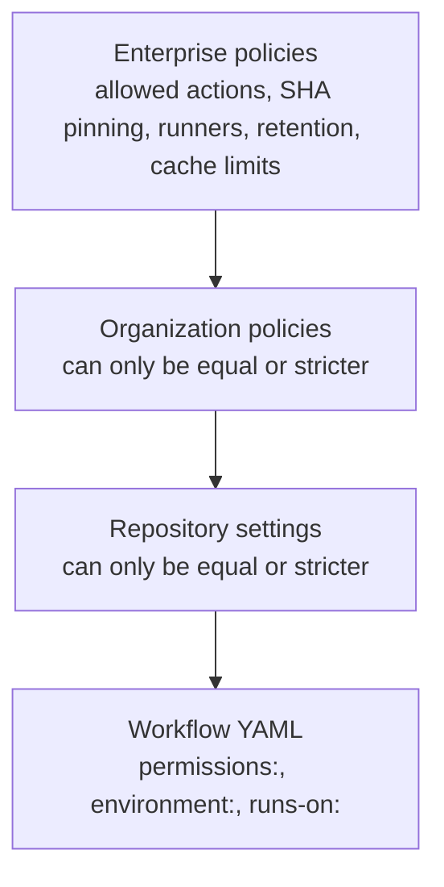
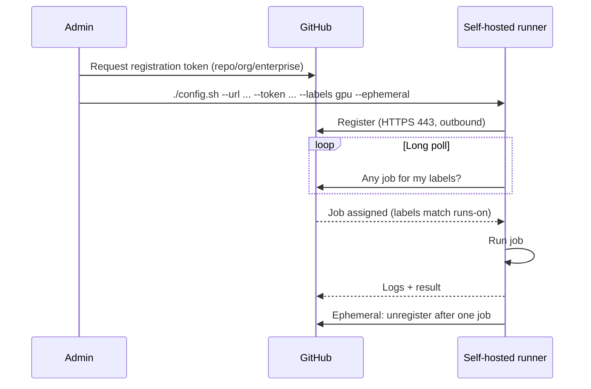
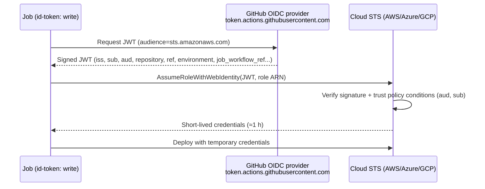

# Day 6 — Enterprise: Runners, Policies, Security, OIDC

> Exam domains: **Manage GitHub Actions for the enterprise (20–25%)** and **Secure and optimize automation (10–15%)**.
> Practice issues: [`label:topic:day-6`](../../issues?q=is%3Aissue+label%3Atopic%3Aday-6)

## Overview

In an enterprise, Actions is a shared platform. Admins decide **where jobs run** (hosted, larger, self-hosted runners, runner groups), **what code may run** (allowed actions, SHA pinning, event policies), **which secrets reach which repos**, and **how much it costs** (usage, retention, budgets). Workflow authors then apply **security hardening**: least-privilege tokens, OIDC instead of stored cloud keys, pinned actions, safe triggers and signed provenance.

## Policy hierarchy



A lower level can **tighten** but not **loosen** a higher level's policy. If the enterprise disables Actions for an org, the org cannot re-enable it.

## Runner types

| Type | Notes |
|---|---|
| **GitHub-hosted** | Managed VMs (Ubuntu, Windows, macOS; x64 and Arm), clean per job, free minutes by plan; Windows and macOS cost more per minute than Linux. `ubuntu-slim` = 1 vCPU low-cost Linux. |
| **Larger runners** | More CPU/RAM/GPU, static IPs, Arm, Azure private networking (VNET injection), autoscaling; paid, Team/Enterprise, org/enterprise level |
| **Self-hosted** | Your machines (VM, bare metal, containers, cloud). You maintain OS, patching, tooling |
| **Actions Runner Controller (ARC)** | Kubernetes operator for autoscaling self-hosted runners with **runner scale sets** (Helm charts `gha-runner-scale-set-controller` + `gha-runner-scale-set`) |

### Self-hosted runner details



- Install runner app, register with a token (repo, org, or enterprise level). Registration tokens expire after one hour.
- Labels: auto labels `self-hosted`, OS (`linux`, `windows`, `macOS`), architecture (`x64`, `ARM64`, `ARM`); add custom labels. Target with `runs-on: [self-hosted, linux, gpu]` (all labels must match).
- Target by group: `runs-on: { group: gpu-runners, labels: [linux] }`.
- **Runner groups** (org/enterprise) control which repos/orgs (and optionally which workflows) can use which runners. Default group: "Default". Up to 10,000 runners per group.
- Outbound only: runner polls GitHub over HTTPS (443); no inbound ports required. Needs access to `github.com`, `api.github.com`, `*.actions.githubusercontent.com`, `codeload.github.com`, results/artifact storage hosts, and `ghcr.io` (immutable actions are stored as packages there). Check the docs list for your setup.
- Proxy support: `https_proxy`, `no_proxy` env vars or a `.env` file in the runner folder.
- **Ephemeral runners** (`--ephemeral`) process one job then unregister; recommended for security and autoscaling. JIT (just-in-time) runners are created by API for one job.
- Not recommended for public repos (anyone can run code via forked PRs).
- Runner software auto-updates; runners must stay within a version window (about 30 days after a new release) or are blocked. `--disableupdate` is only for images you rebuild yourself.
- Service installation: `svc.sh install` / `svc.sh start` (Linux/macOS) or Windows service during `config.cmd`.
- Offline > 14 days removed automatically (ephemeral runners: 1 day).
- Logs on the runner: `_diag/` folder (`Runner_*.log`, `Worker_*.log`).
- Status: Idle, Active, Offline.
- Self-hosted runners can run jobs for up to 5 days; queue wait up to 24 hours.

### Software on runners

- GitHub-hosted images list their preinstalled software in the **runner-images** repo release notes and in the job log ("Runner Image" group → "Included Software" link).
- Tool cache: preinstalled versions of Python, Node, Go, etc. live in `runner.tool_cache`; `setup-*` actions use the cache first, then download.
- Install extra software at runtime: `setup-*` actions, `apt-get`/`choco`/`brew`, container jobs, or a custom image (larger runners support custom images; self-hosted: bake your own image).
- `-latest` labels migrate to new images over weeks; GitHub posts the schedule in the runner-images repo.

### Networking

- **IP allow lists** (org/enterprise): GitHub-hosted standard runners have dynamic IPs and cannot be allow-listed reliably. Use **larger runners with static IPs** (up to 10 per org/enterprise) or self-hosted runners in your network. Admins can automatically add the IPs of installed GitHub Apps.
- **Azure private networking**: larger runners in your Azure VNET reach private resources without public exposure.

## Governance and policies

Set at **enterprise → organization → repository** levels (higher overrides lower).

Settings → Actions → General:
- Allow all actions, disable Actions, allow only org/enterprise-owned, allow GitHub-authored + verified creators + specific patterns (**allow list**), and **block list** patterns (`!owner/action@*`, evaluated last).
- **Require SHA pinning** checkbox: any non-SHA reference to a third-party action fails the workflow.
- **Require lockfile** policy (Oct 2026): workflows must have `.github/workflows/actions.lock`.
- **Fork pull request workflows**: approval requirements (first-time contributors new to GitHub, first-time contributors, all outside collaborators); for private repos: run fork PR workflows at all, send write tokens, send secrets.
- **Default `GITHUB_TOKEN` permissions**: restricted (read contents and packages) vs permissive (read/write); and whether Actions can create/approve PRs.
- **Artifact and log retention** limits.
- Cache size and retention limits (admin configurable).
- **Access**: share private actions and reusable workflows with other repos in the org/enterprise.
- **Actions event policies / workflow execution protections** (GA Sep 2026): rules that allow or block specific triggers. A **default rule blocks `pull_request_target` in public repositories** without their own event policy. It runs in evaluate mode first (policy insights show what would be blocked); **enforcement starts 2 December 2026**. Private/internal repos are not affected. To keep a needed `pull_request_target` workflow, create an event policy that allows it.

Manage by REST, for example: `GET/PUT /repos/{owner}/{repo}/actions/permissions`, `PUT /orgs/{org}/actions/permissions/selected-actions`, `PUT /orgs/{org}/actions/permissions/workflow` (default token permissions).

## Starter workflows and workflow templates

Org-level `.github/workflow-templates/*.yml` + `*.properties.json`; surface in "New workflow." The `.github` repo can be non-public (since Sep 2025). See Day 4.

## Secrets and variables governance

- Organization-level secrets with repository access policy: all, private, or selected repos.
- Enterprise-level Actions secrets are not available; org is the highest level for Actions secrets and variables.
- Environment secrets for deployment gates.
- Rotate secrets; audit via audit log (`org.update_actions_secret`, etc.).
- Programmatic management: REST `actions/secrets` (encrypt with the public key, libsodium sealed box) and `actions/variables` endpoints; `gh secret` / `gh variable`.

## Security hardening

1. Least privilege `GITHUB_TOKEN` (`permissions:` explicitly; default org setting restricted).
2. Pin third-party actions to full SHA (with a `# vX.Y.Z` comment); use Dependabot for actions updates (`package-ecosystem: github-actions`); consider lockfiles and the Require SHA pinning policy.
3. Avoid script injection (pass untrusted input through `env`, quote variables).
4. Don't use `pull_request_target` with checkout of PR head code. `actions/checkout@v7` refuses fork PR head refs in `pull_request_target` and PR-triggered `workflow_run` unless you set `allow-unsafe-pr-checkout: true`.
5. Use **environments** with required reviewers for production.
6. Use **CODEOWNERS** for `.github/workflows/` and `.github/actions/` to review changes; protect with rulesets.
7. Use **OIDC** instead of long-lived cloud credentials.
8. Keep self-hosted runners ephemeral and isolated; separate runner groups for public/untrusted work.
9. Enable secret scanning (push protection) and code scanning (CodeQL can scan workflow files for Actions vulnerabilities).
10. **Artifact attestations** (`actions/attest-build-provenance`) produce SLSA build provenance signed with Sigstore; verify with `gh attestation verify`.
11. Mask sensitive values, never `echo` secrets, avoid structured secrets.
12. Trustworthy Marketplace actions: verified creator, active maintenance, readable source, pinned SHA, minimal permissions in README.

### Artifact attestations

```yaml
permissions:
  contents: read
  id-token: write        # get a Sigstore signing certificate via OIDC
  attestations: write    # store the attestation
steps:
  - uses: actions/checkout@v7
  - run: tar czf app.tgz src/
  - uses: actions/attest-build-provenance@v3
    with:
      subject-path: app.tgz
```

Verify before deploy:

```bash
gh attestation verify app.tgz --repo OWNER/REPO
# For container images:
gh attestation verify oci://ghcr.io/OWNER/IMAGE:TAG --owner OWNER
```

Availability: public repos on all current plans; private/internal repos need GitHub Enterprise Cloud. Attestations are SLSA v1.0 Build Level 2 by default; use a reusable workflow for the build to reach Level 3.

## OIDC (OpenID Connect) with cloud providers



- Workflow requests a short-lived JWT from GitHub's OIDC provider and exchanges it with the cloud (AWS, Azure, GCP, HashiCorp Vault) for temporary credentials. No stored cloud secrets.
- Requires `permissions: id-token: write` (and `contents: read` for checkout).
- Cloud side: configure trust policy with the issuer `https://token.actions.githubusercontent.com` and match claims such as `sub` (e.g., `repo:org/repo:ref:refs/heads/main`, `repo:org/repo:environment:prod`, `repo:org/repo:pull_request`), `aud`, `repository`, `job_workflow_ref` (for reusable workflows).
- Always restrict `sub`. A trust policy that only checks `aud` lets **any** GitHub repo assume the role.
- Orgs/repos can customize the `sub` claim template (REST `actions/oidc/customization/sub`) to include, for example, `repository_owner_id` or `job_workflow_ref`.
- Example for AWS: `aws-actions/configure-aws-credentials` with `role-to-assume`.

```yaml
permissions:
  id-token: write
  contents: read
steps:
  - uses: aws-actions/configure-aws-credentials@v5   # use the latest major; pin to a SHA in real use
    with:
      role-to-assume: arn:aws:iam::123456789012:role/gh-deploy
      aws-region: ap-south-1
```

AWS trust policy (least privilege):

```json
{
  "Effect": "Allow",
  "Principal": { "Federated": "arn:aws:iam::123456789012:oidc-provider/token.actions.githubusercontent.com" },
  "Action": "sts:AssumeRoleWithWebIdentity",
  "Condition": {
    "StringEquals": {
      "token.actions.githubusercontent.com:aud": "sts.amazonaws.com",
      "token.actions.githubusercontent.com:sub": "repo:gvarun17/github-actions-gh200:environment:prod"
    }
  }
}
```

## Billing, usage, and monitoring

- Included usage per plan for private repos (billing docs): Free 2,000 min / 500 MB, Pro 3,000 min / 1 GB, Team 3,000 min / 2 GB, Enterprise Cloud 50,000 min / 50 GB. The limits page now also states included compute as a dollar amount ($12 / $18 / $18 / $300). Included minutes apply to standard runners only, not larger runners.
- Public repos on standard runners are free. Self-hosted runners are free today. GitHub announced a $0.002/min platform charge for self-hosted runners (Dec 2025), then postponed it; re-check before the exam.
- Hosted runner prices dropped up to 39% on 1 Jan 2026. Windows and macOS cost more per minute than Linux.
- Artifacts, caches above the included 10 GB, and Packages share storage billing (hourly accrual).
- Set **budgets** (spending limits) and alerts; view usage in billing and the org **Actions usage metrics** and **performance metrics** pages.
- **Audit log** records Actions-related events (workflow runs, policy changes, secret updates, runner registration). Stream it to a SIEM.

## Migration (awareness)

GitHub provides **GitHub Actions Importer** (CLI, `gh actions-importer`) to audit, forecast, dry-run, and migrate from Jenkins, GitLab CI, CircleCI, Azure DevOps, Travis CI, Bamboo, Bitbucket Pipelines.
Commands: `audit`, `forecast`, `dry-run`, `migrate`.

## GitHub Enterprise Server notes

Uses self-hosted runners only (no GitHub-hosted). Marketplace actions via **GitHub Connect** or `actions-sync` for offline. Reusable workflow limits on GHES are 4 levels and 20 workflows.

## Real-world example

A bank runs 2,000 repos. Policy: only GitHub-authored, verified creators and `bank-org/*` actions; **Require SHA pinning** on; default token read-only; fork PR workflows need approval for all outside collaborators. Production deploys run on an **ephemeral ARC scale set** in a private EKS cluster in runner group `prod-deployers`, available only to 40 repos and only to `bank-org/platform/.github/workflows/deploy.yml@refs/tags/v*`. AWS access uses OIDC with `sub` bound to `environment:prod`. Every image gets a build provenance attestation; the deploy job runs `gh attestation verify` before `kubectl apply`.

## Hands-on

Example files: [`examples/day-6/`](../examples/day-6/).

1. Run [Lab 6](../.github/workflows/lab-6-oidc-permissions.yml). Read the OIDC claims. See the `gh issue create` step fail with 403.
2. Run [Lab 6b — attestation and pinning](../.github/workflows/lab-6b-attest-and-pin.yml). Download the artifact and run `gh attestation verify`.
3. Register an ephemeral self-hosted runner on your Mac (see [LOCAL-SETUP.md](../LOCAL-SETUP.md#day-6-enterprise-runners-security-oidc)).
4. Read `examples/day-6/aws-trust-policy.json` and `examples/day-6/dependabot.yml`.

## Common mistakes

1. **OIDC trust policy without a `sub` condition.** Any repo can assume the role.
2. **`permissions: id-token: write` only.** Checkout fails; add `contents: read`.
3. **Self-hosted runner on a public repo.** A fork PR can run code on your machine.
4. **Persistent (non-ephemeral) runner reused across repos.** Leftover files and credentials leak between jobs.
5. **Allow-listing GitHub-hosted standard runner IPs.** They change; use larger runners with static IPs.
6. **Relying on `pull_request_target` in a public repo after 2 Dec 2026** without an event policy. It is blocked.

## Troubleshooting

| Symptom | Cause | Fix |
|---|---|---|
| Job "Waiting for a runner to pick up this job" | No online runner with all labels; repo not in runner group | Check labels; add repo to the group; check runner status |
| Runner offline | Service stopped; network/proxy; outdated version blocked | `svc.sh status`; check `_diag` logs; update runner |
| `Not authorized to perform sts:AssumeRoleWithWebIdentity` | `sub`/`aud` mismatch | Compare token claims (Lab 6) with trust policy |
| `Error: Unable to get ACTIONS_ID_TOKEN_REQUEST_URL` | Missing `id-token: write` | Add permission (job or workflow) |
| `The action X is not allowed in ORG` | Allowed actions policy | Add to allow list or use an approved action |
| `... must be pinned to a full-length commit SHA` | Require SHA pinning policy | Pin to 40-char SHA |
| `pull_request_target` run blocked | Default event policy (public repo) | Switch to `pull_request` or add an event policy |
| `gh attestation verify` fails | Wrong repo/owner; artifact changed; no attestation | Use the right `--repo`; rebuild; check `attestations: write` |

## Exam notes

- Policy hierarchy: enterprise → org → repo; lower can only be stricter.
- Self-hosted: outbound 443 only; ephemeral recommended; removed after 14 days offline.
- Runner groups control access by repo/org (and workflow).
- OIDC: `id-token: write`; trust on `iss` + `aud` + `sub`.
- Attestations: `id-token: write` + `attestations: write`; verify with `gh attestation verify`.
- Static IPs → larger runners.
- Trick: "Most secure way to give a workflow AWS access" → OIDC with a `sub`-scoped role, not access keys in secrets.

## References

- [About self-hosted runners](https://docs.github.com/en/actions/concepts/runners/self-hosted-runners)
- [Runner groups](https://docs.github.com/en/actions/how-tos/manage-runners/self-hosted-runners/manage-access)
- [Actions Runner Controller](https://docs.github.com/en/actions/concepts/runners/actions-runner-controller)
- [Larger runners](https://docs.github.com/en/actions/concepts/runners/larger-runners)
- [Security hardening / secure use](https://docs.github.com/en/actions/reference/security/secure-use)
- [OpenID Connect](https://docs.github.com/en/actions/concepts/security/openid-connect)
- [Artifact attestations](https://docs.github.com/en/actions/concepts/security/artifact-attestations)
- [Securely using pull_request_target](https://docs.github.com/en/actions/reference/security/securely-using-pull_request_target)
- [SHA pinning policy (changelog)](https://github.blog/changelog/2025-08-15-github-actions-policy-now-supports-blocking-and-sha-pinning-actions/)
- [Actions billing](https://docs.github.com/en/billing/concepts/product-billing/github-actions)
- [Pricing changes 2026](https://github.blog/changelog/2025-12-16-coming-soon-simpler-pricing-and-a-better-experience-for-github-actions/)

## Check yourself

1. Which runner type needs no inbound firewall rules?
2. Why use ephemeral self-hosted runners?
3. Which two permissions does an OIDC deploy usually need? Which three does an attestation need?
4. What does a runner group control?
5. Where do you restrict which actions can be used across an org?
6. Which tool helps migrate from Jenkins?
7. What is the most secure way to reference a third-party action?
8. Your security team needs a fixed source IP for a firewall rule. Which runner option works?
9. What happens to a `pull_request_target` workflow in a public repo after 2 December 2026?
