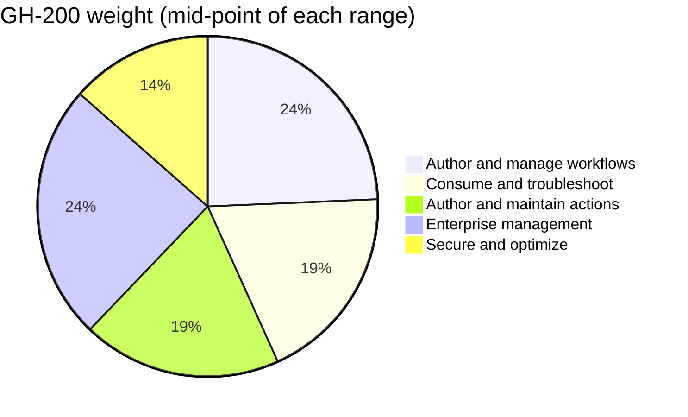
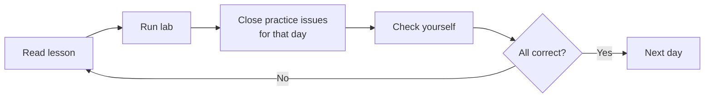

# Day 7 — Review, Cheat Sheet, and Practice Exam

> Covers all five domains of the January 2026 GH-200 outline.
> Practice issues: [`label:topic:day-7`](https://github.com/gvarun17/github-actions-gh200/issues?q=is%3Aissue+label%3Atopic%3Aday-7)

## Exam blueprint (skills measured as of January 2026)

| # | Domain | Weight | Course days |
|---|---|---|---|
| 1 | Author and manage workflows | 20–25% | 1, 2, 3, 4 |
| 2 | Consume and troubleshoot workflows | 15–20% | 1, 3, 4 |
| 3 | Author and maintain actions | 15–20% | 5 |
| 4 | Manage GitHub Actions for the enterprise | 20–25% | 2, 6 |
| 5 | Secure and optimize automation | 10–15% | 2, 4, 6 |

Logistics: 100 minutes, passing score 700/1000, valid 2 years, booked through Microsoft Learn (Pearson VUE). Price depends on country (about USD 99). Verify on the official page before you book.

## Topics added in the January 2026 outline (check you can answer each)

- [ ] YAML anchors and aliases; merge keys are **not** supported (Day 1)
- [ ] Editor tooling: VS Code GitHub Actions extension, schema validation (Day 1)
- [ ] Static vs runtime expression evaluation; secret leakage in expressions (Day 2)
- [ ] REST APIs for secrets/variables and for artifact/log retention (Days 2, 3)
- [ ] Matrix analysis: correlate job names to axes; re-run one matrix job (Day 3)
- [ ] Runner image changes (`windows-latest` → Server 2025; Ubuntu 20.04 retired) (Day 3)
- [ ] Non-public workflow templates; template vs reusable vs composite; disable vs delete (Day 4)
- [ ] Immutable actions/releases and pinning (Days 5, 6)
- [ ] Preinstalled software, tool cache, installing software at runtime (Day 6)
- [ ] IP allow lists and runner networking (Day 6)
- [ ] Artifact attestations: generate and verify (Day 6)

## Cheat sheet

| Need | Answer |
|---|---|
| Workflow location | `.github/workflows/*.yml` |
| Manual trigger | `workflow_dispatch` |
| Call another workflow | `on: workflow_call` + job-level `uses:` |
| Run after another workflow | `workflow_run` |
| External trigger via API | `repository_dispatch` |
| Cron | `schedule` (UTC, default branch) |
| Persist env to later steps | `echo "A=b" >> $GITHUB_ENV` |
| Step output | `echo "k=v" >> $GITHUB_OUTPUT` |
| Job output | `jobs.<id>.outputs` → `needs.<id>.outputs.k` |
| Job dependency | `needs` |
| Always run | `if: always()` |
| Matrix | `strategy.matrix`; `include`/`exclude`; `fail-fast`; `max-parallel` |
| Dynamic matrix | `fromJSON()` |
| Share files between jobs | upload/download-artifact |
| Speed up dependencies | `actions/cache` (`key`, `restore-keys`) |
| Databases for tests | `services:` |
| Serialize deploys | `concurrency` |
| Approval before deploy | environment required reviewers |
| Cloud auth without secrets | OIDC, `id-token: write` |
| Least privilege token | `permissions:` |
| Docker action runs on | Linux only |
| Composite `run` requires | `shell:` |
| Action metadata file | `action.yml` |
| Version pinning (most secure) | full commit SHA |
| Debug logs | `ACTIONS_STEP_DEBUG`, `ACTIONS_RUNNER_DEBUG` |
| Self-hosted label targeting | `runs-on: [self-hosted, linux, x64]` |
| Limit allowed actions | Org/enterprise Actions policy |
| Migrate CI | GitHub Actions Importer |
| Reuse config inside one file | YAML anchors `&` / aliases `*` (no `<<` merge) |
| Every queued deploy must run | `concurrency` + `queue: max` |
| Run on success or failure, not cancel | `if: ${{ !cancelled() }}` |
| Fixed egress IP | Larger runner with static IP, or self-hosted |
| Prove build origin | `actions/attest-build-provenance` + `gh attestation verify` |
| Force SHA pins org-wide | "Require SHA pinning" policy |
| JS action runtime | `using: node24` |
| Reusable workflow limits (github.com) | 10 levels, 50 workflows |
| Artifact retention max | public 90 days, private 400 days |

## Common traps

1. `GITHUB_TOKEN`-triggered events don't start new runs (except `workflow_dispatch`, `repository_dispatch`).
2. Secrets aren't available to fork PRs; `pull_request_target` is risky.
3. `schedule` and `workflow_dispatch` need the file on the default branch.
4. `branches` + `branches-ignore` conflict; use `!` patterns.
5. Reusable workflows are called at job level; composite actions are called as steps.
6. Setting any `permissions` key zeros the rest.
7. Composite action `run` without `shell` is an error.
8. Cache is branch-scoped (can read from current, base, default).
9. Environment secrets require the job to reference the environment.
10. `outcome` vs `conclusion` differ when `continue-on-error: true`.
11. `always()` still runs after a cancel; use `!cancelled()` to stop on cancel.
12. `secrets` cannot be used directly in `if:`; map to `env` first.
13. YAML merge keys (`<<:`) are invalid in workflows; anchors and aliases are valid.
14. `secrets: inherit` does not pass environment secrets.
15. `pull_request_target` in public repos is blocked by default from 2 Dec 2026 unless an event policy allows it.

## Practice questions

1. Which event lets you start a workflow from the UI with typed inputs?
   A) `repository_dispatch` B) `workflow_dispatch` C) `workflow_call` D) `schedule`
2. A job should run even when a previous job failed. What do you add?
   A) `continue-on-error: false` B) `if: always()` C) `needs: none` D) `retry: true`
3. You need job B to use a value produced by job A. What is needed?
   A) `env` at workflow level B) job output in A and `needs` in B C) cache D) secret
4. Which allows a workflow to authenticate to AWS without storing long-lived keys?
   A) PAT B) OIDC with `id-token: write` C) Deploy key D) Dependabot secret
5. How do you run one workflow from another workflow file as a reusable unit?
   A) `uses:` at step level with a workflow path B) `uses:` at job level with `workflow_call` target C) `include:` D) `needs:`
6. Which runner type can run Docker container actions?
   A) Windows B) macOS C) Linux D) all
7. Which is the most secure way to reference a marketplace action?
   A) `@main` B) `@v1` C) `@<full-sha>` D) no ref
8. What stops two deploys of the same app from running at once?
   A) `max-parallel` B) `concurrency` group C) matrix D) `timeout-minutes`
9. Which file declares inputs/outputs for a custom action?
   A) `workflow.yml` B) `action.yml` C) `package.json` D) `.actionrc`
10. Production deploy must wait for manual approval. Use:
    A) Wait timer in workflow B) Environment with required reviewers C) CODEOWNERS D) `if: manual`
11. Which `GITHUB_TOKEN` permissions config removes all permissions?
    A) `permissions: read-all` B) `permissions: {}` C) `permissions: none-all` D) omit key
12. Where do you add a secret that should be available to many repos in an org?
    A) Repository secret B) Organization secret with repo access policy C) Environment secret D) Codespaces secret
13. Which is a risk of `run: echo "${{ github.event.issue.title }}"`?
    A) Cache miss B) Script injection C) Rate limit D) Timeout
14. A matrix should not cancel other jobs when one fails. Which setting?
    A) `fail-fast: false` B) `max-parallel: 1` C) `continue-on-error` at workflow D) `cancel-in-progress: false`
15. What makes a self-hosted runner execute exactly one job then deregister?
    A) `--once` B) `--ephemeral` C) `--single` D) runner group
16. Which tool helps convert existing Jenkins pipelines?
    A) Actions Importer B) Dependabot C) CodeQL D) Copilot
17. In a composite action, a step with `run:` must include:
    A) `if:` B) `shell:` C) `id:` D) `name:`
18. How do you pass all caller secrets to a reusable workflow?
    A) `secrets: all` B) `secrets: inherit` C) `env: inherit` D) not possible
19. A cache restore falls back to an older cache whose key starts with the same prefix. Which setting?
    A) `fallback-keys` B) `restore-keys` C) `path` D) `retention-days`
20. Which variable enables step debug logs?
    A) `ACTIONS_STEP_DEBUG=true` B) `RUNNER_DEBUG=1` C) `DEBUG=true` D) `ACTIONS_LOG=verbose`

21. A workflow uses `paths: &p ['src/**']` under `push` and `paths: *p` under `pull_request`. What happens?
    A) Invalid YAML B) Both events use the same path filter C) Only push is filtered D) Aliases are ignored
22. Which key is NOT valid in a GitHub Actions workflow?
    A) `&defaults` anchor B) `*defaults` alias C) `<<: *defaults` merge key D) `run-name`
23. A cleanup job must run when the build fails but must stop if a user cancels the run. Which condition?
    A) `if: always()` B) `if: ${{ !cancelled() }}` C) `if: failure()` D) `if: success()`
24. Three deploys are triggered within one minute. All must run, in order. What do you configure?
    A) `cancel-in-progress: true` B) `concurrency` with `queue: max` C) `max-parallel: 1` D) environment wait timer
25. Which runtime must a new JavaScript action declare?
    A) `node16` B) `node20` C) `node24` D) `node`
26. Which permissions are needed to create an artifact attestation?
    A) `contents: write` B) `id-token: write` and `attestations: write` C) `packages: write` only D) `actions: write`
27. A firewall team needs a fixed source IP for jobs on GitHub-hosted runners. What do you use?
    A) Standard runners B) Larger runners with static IP C) `ubuntu-slim` D) A runner group on standard runners
28. What is the maximum artifact retention for a private repository?
    A) 30 days B) 90 days C) 400 days D) Unlimited
29. A matrix job `build (windows-latest, 3.12)` failed. What is the fastest way to retry only it?
    A) Re-run all jobs B) Re-run that single job C) Push an empty commit D) Disable the workflow
30. An org wants every repo to start from a standard CI file, but each team may change its copy. Use:
    A) Reusable workflow B) Workflow template in the org `.github` repo C) Composite action D) Required workflow
31. Which statement about `GITHUB_TOKEN` is correct?
    A) It lasts 1 year B) It is scoped to the current repository and expires when the job ends C) It can trigger new push workflows D) It is tied to the user who pushed
32. A reusable workflow needs an environment secret `DB_PASS`. Where must `environment:` be declared?
    A) In the caller job B) In a job inside the called workflow C) At workflow level D) In `secrets: inherit`
33. Which context can you use in `jobs.<id>.runs-on`?
    A) `env` B) `steps` C) `matrix` D) `secrets`
34. You want to stop a workflow temporarily and keep its history. What do you do?
    A) Delete the file B) Disable the workflow C) Delete all runs D) Remove `on:`
35. How do you list secret names of a repository by API?
    A) `GET /repos/{o}/{r}/actions/secrets` B) `GET /repos/{o}/{r}/secrets/values` C) Not possible D) `GET /orgs/{o}/secrets`

### Answers

1 B · 2 B · 3 B · 4 B · 5 B · 6 C · 7 C · 8 B · 9 B · 10 B · 11 B · 12 B · 13 B · 14 A · 15 B · 16 A · 17 B · 18 B · 19 B · 20 A
21 B · 22 C · 23 B · 24 B · 25 C · 26 B · 27 B · 28 C · 29 B · 30 B · 31 B · 32 B · 33 C · 34 B · 35 A

## Final-day plan

1. Retake every "Check yourself" list from Days 1–6 aloud (45 min).
2. Take the practice questions untimed, then review misses (45 min).
3. Re-run any lab you found confusing (30 min).
4. Tick every box in "Topics added in the January 2026 outline". Re-read the lesson for any unticked box.
5. Take Microsoft's free GH-200 practice assessment on Microsoft Learn.
6. Book the exam; sleep.

## Exam day tips

- Read each question twice: look for words like "most secure," "least effort," "without storing credentials."
- Eliminate options that don't exist (invented keys) first.
- Many questions show YAML with a subtle bug (indentation, missing `needs`, missing `shell`, wrong context). Read the YAML literally.
- Flag and return; don't burn time on one question.

## Study flow

## References

- [GH-200 study guide (skills measured Jan 2026)](https://learn.microsoft.com/credentials/certifications/resources/study-guides/gh-200)
- [GitHub Actions certification page](https://learn.microsoft.com/credentials/certifications/github-actions)
- [GitHub Actions documentation](https://docs.github.com/en/actions)
- [GitHub Changelog — Actions](https://github.blog/changelog/label/actions)
